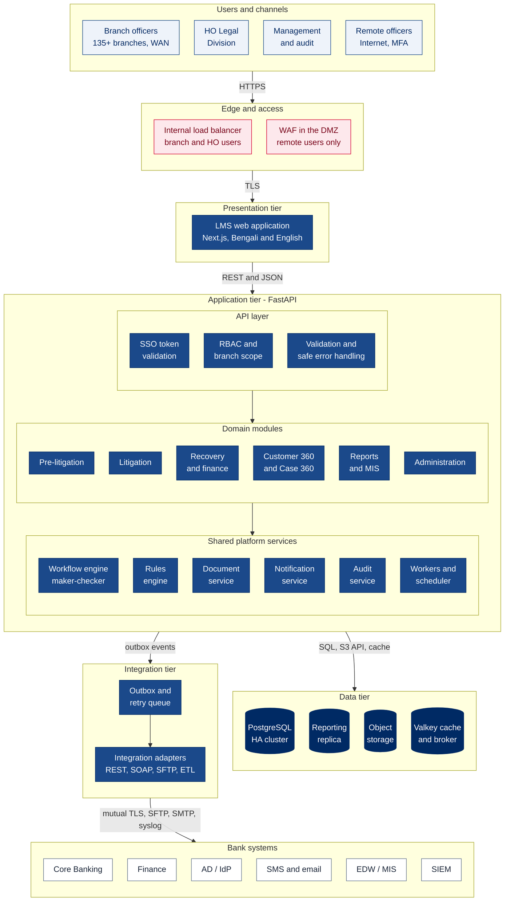
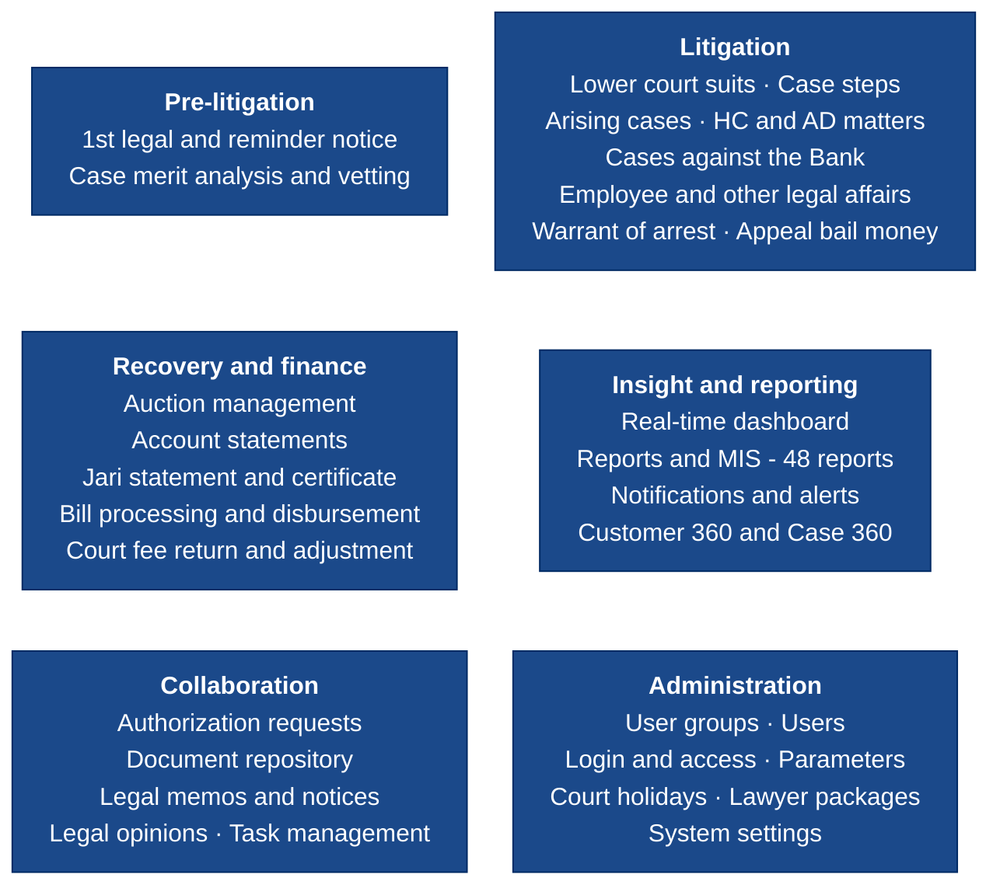
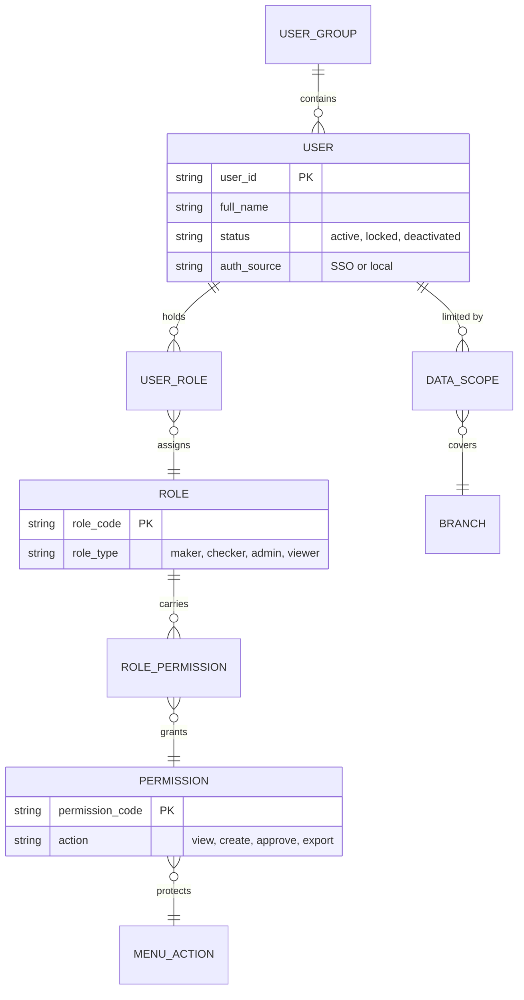

# 1. System Architecture

[← Back to index](README.md)

The LMS is a web-based, N-tier application (RFP §7.1.1) that centralises the Bank's legal lifecycle — pre-litigation, litigation, auction, recovery and settlement — on one platform, integrated with the Core Banking System (CBS) and the Bank's enterprise systems. This document describes the logical architecture: the tiers, the components inside them, and the principles that bind them.

## 1.1 Design principles

| Principle | What it means in this design | RFP |
|---|---|---|
| N-tier, stateless application tier | Web, API and data tiers are separated; web and API nodes hold no session state, so any node can serve any request and nodes scale out behind a load balancer | §7.1.1 |
| Modular monolith | One deployable application organised into domain modules with clear internal boundaries. Right-sized for ~600 users, simpler for Bank ICT to operate, and keeps a request, its approval and its audit entry in one database transaction | §7.1.1 |
| Maker–checker by design | A single workflow engine handles every request type; no module implements its own approval logic | §8.9–§8.24 |
| Audit by default | Every create, view, change, approval and login is recorded automatically by the platform, not by each screen | §7.9.12, §8.29.15 |
| Integration through adapters | Each external system is reached through its own adapter, so a CBS or Finance change touches one component | §4(a), §7.3 |
| Configure, don't code | Parameters, approval tiers, notification lead times, TAT thresholds and report templates are data, maintained by administrators | §7.2.8, §7.6.1, §8.4 |
| Security in depth | Controls at the network, identity, application and data layers; no single control is relied on alone | §7.11 |
| Open standards | REST/OpenAPI, SOAP where CBS requires it, SAML/OIDC, SQL, S3, syslog — no proprietary runtime lock-in | §7.3.1, §7.3.7 |

## 1.2 Logical architecture

**How a request moves through the tiers.** A branch officer's browser calls the LMS over HTTPS through the internal load balancer (remote officers come in through the WAF in the DMZ). The web tier serves the interface; every data operation goes to the API layer, which authenticates the user, checks the role and branch scope, and validates the input before handing off to a domain module. Domain modules use the shared platform services — the workflow engine for approvals, the rules engine for TATs and lead times, the document service for files, and the audit service for the trail. Anything that must happen outside the request (an SMS, a CBS posting, a report run) is written to the outbox in the same transaction and picked up by background workers, which call external systems through the integration adapters.

## 1.3 Component catalogue

| Tier | Component | Responsibility | Scaling and availability |
|---|---|---|---|
| Edge | WAF and reverse proxy | Publishes the LMS to remote users only; OWASP rule set, rate limiting, TLS | Active–active pair in the DMZ |
| Edge | Internal load balancer | Single virtual IP for branch and HO users; TLS, health checks, routes `/` to web and `/api` to API nodes | Bank load balancer pair |
| Presentation | Web application | Next.js interface, responsive for desktop, tablet and mobile; offline entry queue for remote officers; Bengali and English | Two or more stateless nodes |
| Application | API layer | Authentication (SSO token validation), RBAC and branch scoping, request validation, error handling that never exposes server internals (RFP §7.11.8) | Two or more stateless nodes |
| Application | Domain modules | The 31 RFP §8 modules grouped into six domains (§1.4) | Scale with the API nodes |
| Application | Workflow engine | Maker–checker state machine, configurable tiers, sequential and parallel stages (RFP §7.5.1), duplicate-request blocking, reasons on return and reject | Shared library inside the application |
| Application | Business rules engine | Configurable rules for TATs, escalation thresholds, notification lead times and validations (RFP §7.6.1) | Rules stored in the database, cached |
| Application | Document service | Upload, metadata, search and controlled download of case documents; short-lived signed download links | Backed by object storage |
| Application | Notification service | Builds SMS, email and in-app messages from templates; tracks delivery; escalates when unacknowledged | Delivery through workers |
| Application | Audit service | Append-only, hash-chained audit log; login, view, change and approval events; feeds SIEM | Writes in the business transaction |
| Application | Workers and scheduler | Notifications, report generation, CBS end-of-day sync, retries | Two or more nodes, one active scheduler |
| Integration | Integration adapters | One adapter per external system: protocol, mapping, timeouts, circuit breaker | Two nodes on the integration VLAN |
| Integration | Outbox and retry queue | Guarantees that every posting and notification committed in the LMS is eventually delivered exactly once | Outbox in PostgreSQL; queue in Valkey |
| Data | PostgreSQL HA cluster | System of record for cases, requests, workflow, users and audit | Primary plus synchronous standby in DC; replicas at NDR and DR |
| Data | Reporting replica | Read-only copy for heavy reports and MIS, so reporting never slows data entry | Streaming replica |
| Data | Object storage | Scanned plaints, court orders, deeds, notices; versioned and encrypted | Erasure-coded cluster, replicated to DR |
| Data | Valkey | Cache for reference data and sessions, broker for background jobs | Three nodes with Sentinel |

## 1.4 Functional architecture

Thirty-one functional modules from RFP Section 8, grouped into six domains, plus a cross-module Case 360 view.

## 1.5 Cross-cutting mechanisms

**Maker–checker.** Every request type is configured with its approval tiers (branch only, HO only, or branch then HO). The engine enforces the RFP rules that repeat across Section 8: a second request for the same entity is blocked while one is pending, and the user is shown the pending reference number; requests are editable only while *Draft* or *Returned*; return and reject always carry a reason; every transition is recorded and visible in the enquiry view. Details in [Workflow Diagram](02-workflow-diagram.md).

**Access control.** Users belong to user groups and hold one or more roles; roles carry permissions on menus and actions; a data scope limits each user to their branch or region, or grants all branches to Head Office roles (RFP §7.7.1, §7.9.7–§7.9.10). Session timeout, password policy, lockout and CAPTCHA thresholds are configurable (RFP §8.29).

**Audit trail.** The audit service records who did what, when, from which IP and workstation, with before and after values. Entries are append-only (the application's database role cannot update or delete them), each entry carries a hash of the previous one so tampering is detectable, and the stream is forwarded to the Bank's SIEM (RFP §7.9.12, §8.29.10–§8.29.15).

**Versioning and restore.** Every change to a record keeps the prior version, so an authorised user can view history and restore an earlier version (RFP §7.4.1).

**Configuration.** Reference lists (RFP §8.4), court holidays (§8.5), lawyer packages (§8.6), approval tiers, notification templates and report layouts are maintained through administration screens, each change itself maker–checked and audited.

**Language and branding.** All user-facing text is externalised for Bengali and English (RFP §7.2.5); the Bank Asia logo appears on screens, printed statements and reports (RFP §7.2.9).

## 1.6 Quality attributes

| Attribute | Target | How the architecture achieves it | RFP |
|---|---|---|---|
| Availability | 99.95% within DC; continuity through DR | Redundant nodes in every tier, automatic database failover, synchronous NDR copy, warm DR site | §7.10.1, §7.10.2 |
| Data durability | No loss of a committed transaction | Synchronous replication to NDR, continuous WAL archiving, point-in-time recovery | §7.10.3, §7.10.4 |
| Performance | p95 under 500 ms for screens; under 2 s for CBS-backed screens; heavy reports run in the background | Stateless scale-out, caching of reference data, reporting replica, asynchronous report jobs | Non-functional requirements |
| Security | OWASP Top 10, encryption in transit and at rest | Layered controls; see [Data Flow Diagram](03-dataflow-diagram.md) and [Risk Management](08-risk-management.md) | §7.11 |
| Scalability | Add users and branches without redesign | Horizontal scaling of web, API and worker nodes; database sized for six years of growth | §7.1.1 |
| Maintainability | Changes isolated to one module or adapter | Domain modules, adapters per external system, configuration over code | §7.3.3 |
| Compatibility | Current browsers; upgradeable OS, database and middleware | Standards-based stack, version roadmap maintained under AMC | §7.11.4, §7.11.11 |
| Observability | Faults detected before users report them | Metrics, logs and traces with alerting; batch success and failure reports | §7.2.3, §7.10.5, §7.11.7 |
