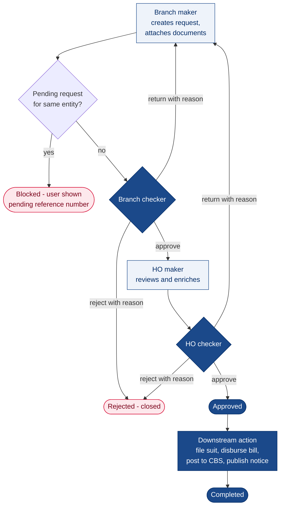
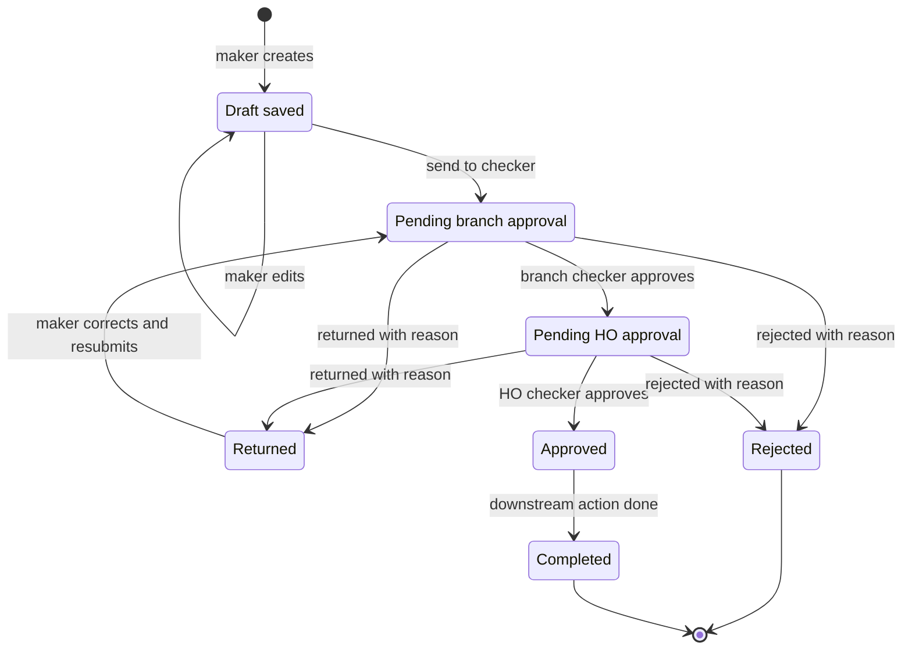
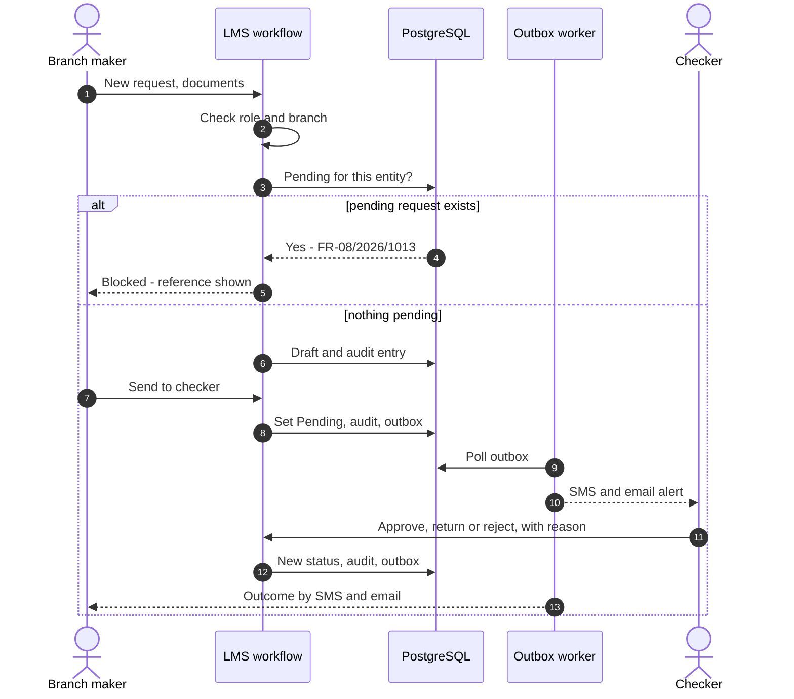
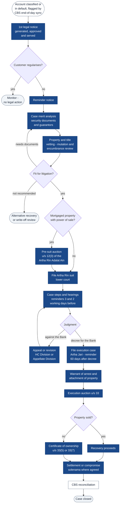
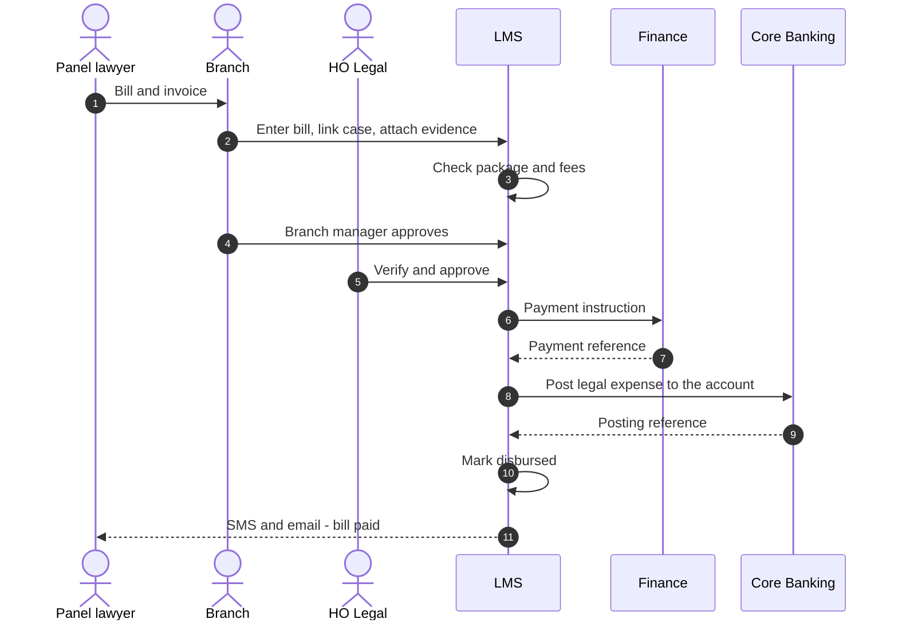
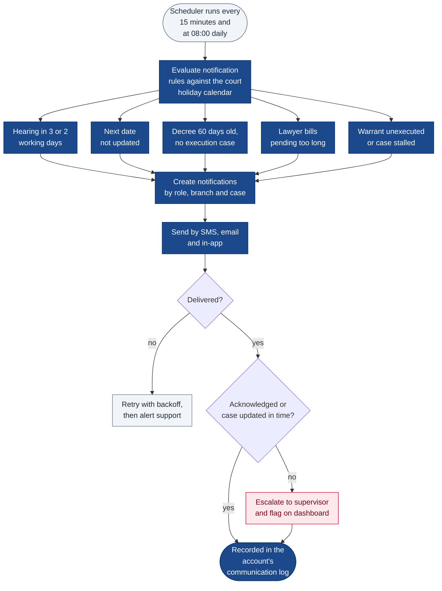

# 2. Workflow Diagram

[← Back to index](README.md)

Almost every module in RFP Section 8 follows the same pattern: a request is made at branch level, checked at branch level, then made and checked at Head Office, with every step recorded. The LMS implements this once, in a shared workflow engine, and configures it per request type. This document shows that approval workflow, the end-to-end legal case lifecycle the modules support, and the bill disbursement and notification workflows.

## 2.1 Approval chain (maker–checker)

Each request type is configured with one or two approval tiers. The diagram shows the full two-tier chain used by, for example, Case Merit Analysis (RFP §8.9), Authorization Requests (§8.21) and Bill Disbursement (§8.16). Single-tier request types skip the tier they do not need.

## 2.2 Request statuses

The same statuses appear in every module, so a user who has learned one screen has learned them all.

| Rule | Enforced by | RFP |
|---|---|---|
| A new request is blocked while one is pending for the same customer or case; the existing reference number is shown | Workflow engine | §8.9.13–§8.9.14 and equivalents |
| Requests are editable only in *Draft saved* or *Returned* | Workflow engine | §8.9.17 and equivalents |
| Return and reject always require a reason | Workflow engine | §8.9.15 and equivalents |
| Every transition records user, role, time, from-status, to-status and reason | Audit service | §8.9.18 and equivalents |
| Current status and full history are available through enquiry at any time | Enquiry view | §8.9.11 and equivalents |
| Email and SMS go to the next actor on initiate, return, reject and complete | Notification service | §8.9.12 and equivalents |
| A maker cannot approve their own request | RBAC | §7.9.9 |

## 2.3 Request processing — step by step

*LMS workflow* is the API layer and workflow engine together. Each status change, its audit entry and its outbox event are written in one database transaction, so a notification can never refer to a change that was not saved.

## 2.4 End-to-end legal case lifecycle

The typical path of a defaulted account from first notice to closure, with the LMS module that supports each step. Cases against the Bank (RFP §8.19) and employee and other legal affairs (§8.20) follow their own shorter lifecycles on the same workflow engine.

| Lifecycle stage | LMS module | RFP |
|---|---|---|
| Default identified | CBS end-of-day sync, dashboard | §4(a), §7.2.14, §8.7 |
| Notices | 1st Legal Notice / Reminder Notice | §8.8 |
| Merit and vetting | Case Merit Analysis, pre-litigation TAT, land and property vetting | §8.9.19, §8.9.20 |
| Pre-suit and execution auctions | Auction Management, publication copies | §8.10 |
| Suit and hearings | Lower Court Suits, Case Steps Update | §8.13, §8.14 |
| Appeals | HC and AD Matters | §8.18 |
| Execution | Arising Cases, Warrant of Arrest, Appeal Bail Money | §8.15, §8.22, §8.23 |
| Statements | Account Statement, Jari Statement and Certificate | §8.11, §8.12 |
| Recovery and settlement | Bill Processing (recovery and settlement workflow), CBS reconciliation | §8.16.22 |
| Expenses at every stage | Bill Processing, Court Fee Return and Adjustment, Lawyer Packages | §8.6, §8.16, §8.17 |

The steps and statutory sections shown are the typical path; the case-step catalogue (RFP §8.4.13) is configurable, so the Legal Division can add or reorder steps without a software change.

## 2.5 Bill processing and disbursement

*Branch* is the branch legal officer, who enters the bill as maker, and the branch manager, who approves it as checker. The bill memo can be downloaded as a PDF for physical signature at any point (RFP §8.16.15). If Finance or CBS is unavailable, the instruction stays in the outbox and is retried; it is never sent twice (see [Integration Diagram](05-integration-diagram.md)).

## 2.6 Notifications and escalation

| Rule | Recipients | Default timing (configurable) | RFP |
|---|---|---|---|
| Upcoming hearing | Case dealing officer, branch manager, lawyer | 3 and 2 working days before | §8.26.2, §8.14.9 |
| Next date not updated | Case dealing officer, supervisor | Day after the hearing | §8.26.3, §8.14.15 |
| Execution not filed after decree | Case dealing officer, HO Legal | 60 days after decree | §8.26.1 |
| Certificate-owned property follow-up | HO Legal | Interval set by the Bank | §8.26.4 |
| Long-pending lawyer bills | Lawyer | Threshold set by the Bank | §8.26.5 |
| Lawyer update overdue | Lawyer | After each fixed date | §8.26.6 |
| Unexecuted warrant | Case dealing officer, supervisor | Threshold set by the Bank | §8.22.12 |
