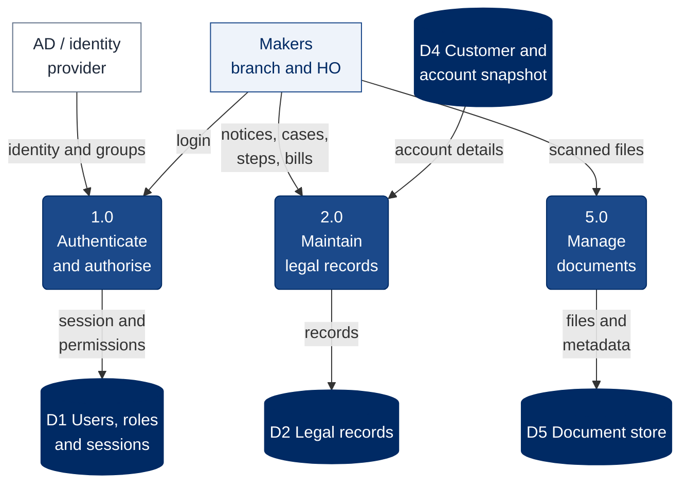
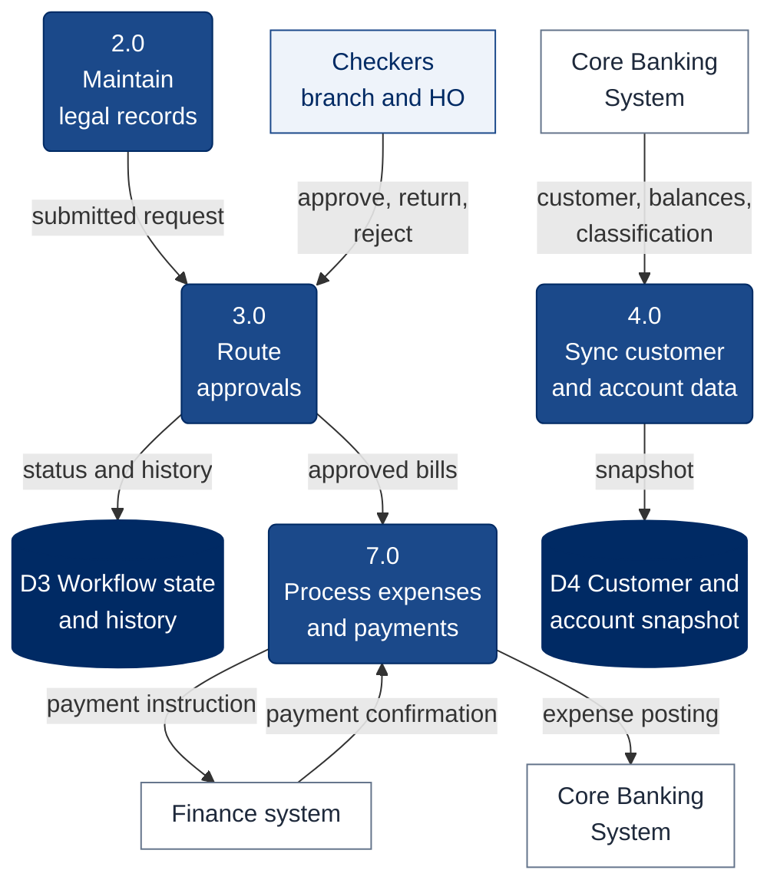
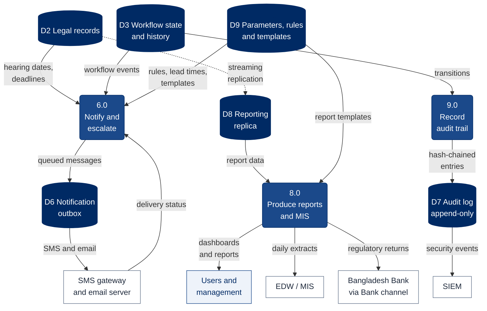
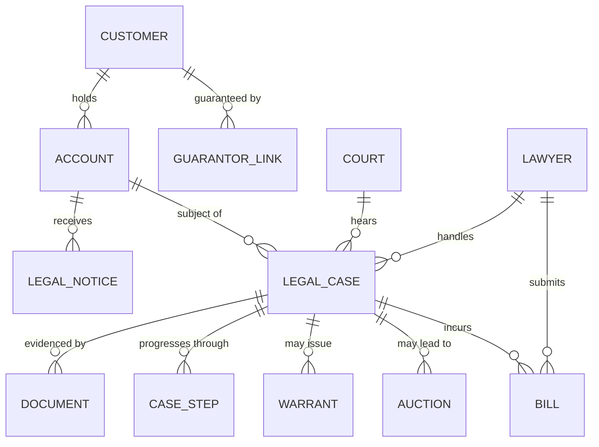
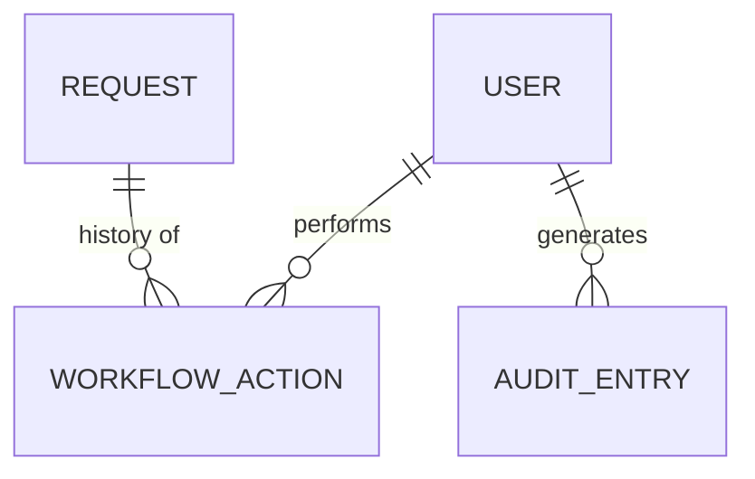
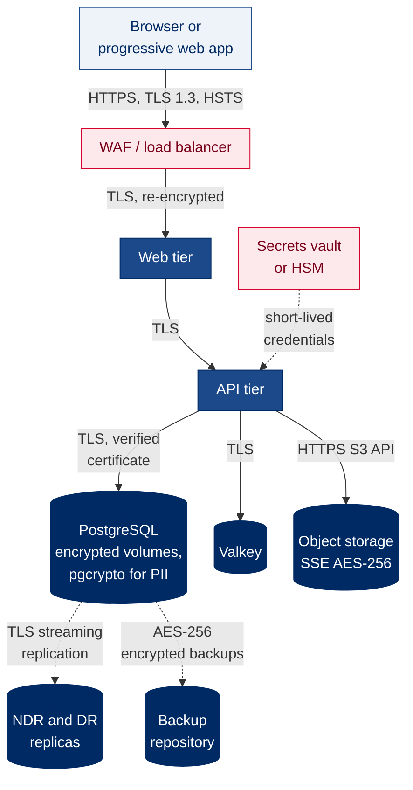
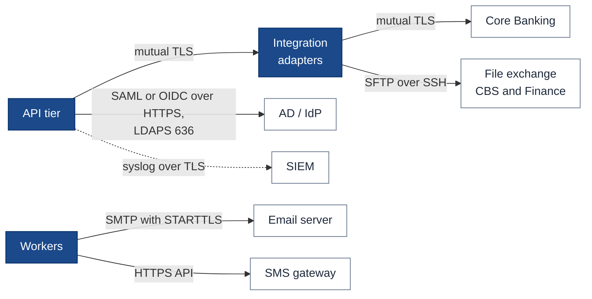

# 3. Data Flow Diagram

[← Back to index](README.md)

This document decomposes the LMS into its main processes and data stores (a Level-1 data flow diagram), shows the logical data model behind them, and describes how data is protected on every hop and at rest (RFP §7.1.1(h): *data flow diagrams with security and encryption descriptions*). The Level-0 view, with the LMS as a single process, is in [Level-0 (Context) Diagram](06-level-0-context-diagram.md).

## 3.1 Level-1 data flow diagram — capture and records

The Level-1 diagram is drawn in three parts so that each stays readable; together they cover processes 1.0 to 9.0 and data stores D1 to D9. Processes are numbered rounded boxes (Gane–Sarson notation), data stores are cylinders, external entities are rectangles.

## 3.2 Level-1 data flow diagram — approval, account sync and payments

The Core Banking System is drawn twice, as the source of account data and as the receiver of expense postings, so that its flows do not cross the diagram.

## 3.3 Level-1 data flow diagram — notification, reporting and audit

| Process | Description | Key inputs | Key outputs |
|---|---|---|---|
| 1.0 Authenticate and authorise | SSO login or local login with lockout; builds the user's roles, permissions and branch scope | Credentials or SSO assertion, AD groups | Session, permission set |
| 2.0 Maintain legal records | Create and update notices, CMA, suits, steps, HC/AD matters, warrants, bail, bills | User entries, CBS account details | Legal records |
| 3.0 Route approvals | Maker–checker transitions across branch and HO tiers | Submitted requests, checker decisions | Status, history, workflow events |
| 4.0 Sync customer and account data | Real-time lookup and end-of-day sync from CBS | CBS responses and extracts | Account snapshot, new-default flags |
| 5.0 Manage documents | Upload, classify, search and download legal documents | Files and metadata | Stored objects, access log |
| 6.0 Notify and escalate | Evaluate rules, queue and send messages, escalate when unacknowledged | Deadlines, events, rules | SMS, email, in-app alerts |
| 7.0 Process expenses and payments | Lawyer, court, publication and other bills to payment and CBS posting | Approved bills | Payment instructions, CBS postings |
| 8.0 Produce reports and MIS | Dashboards, 48 reports, Bangladesh Bank formats, EDW extracts | Reporting replica, templates | Reports, extracts |
| 9.0 Record audit trail | Capture every login, view, change and approval | All process events | Tamper-evident audit log |

Courts are not connected to the LMS. Hearing dates, orders and judgments enter through legal officers in process 2.0 and are attached as documents in process 5.0.

## 3.4 Logical data model — core entities

**Customer, account and case**

**Workflow, users and audit**

| Entity | Key attributes |
|---|---|
| ACCOUNT | `account_no` (PK), `branch_code`, `outstanding`, `classification`, `snapshot_as_of` |
| LEGAL_CASE | `case_id` (PK), `suit_no`, `case_type`, `court_id` (FK), `lawyer_id` (FK), `parent_case_id` (FK, set on arising cases such as appeals, revisions and execution cases), `status`, `filed_on`, `next_hearing`, `claim_amount` |
| CASE_STEP | `step_id` (PK), `case_id` (FK), `step_date`, `step_taken`, `next_date` |
| BILL | `bill_id` (PK), `bill_type`, `amount`, `payment_ref`, `cbs_posting_ref` |
| DOCUMENT | `document_id` (PK), `document_type`, `object_key`, `sha256` |
| REQUEST | `request_id` (PK), `request_type`, `entity_ref`, `status` |
| AUDIT_ENTRY | `seq` (PK), `actor`, `action`, `before_after`, `prev_hash` |

The full data dictionary (RFP §7.1.1(i)) is produced during the design phase from this model. Every business entity carries `created_by`, `created_at`, `updated_by`, `updated_at` and a version number, which is what makes history and restore possible (RFP §7.4.1).

## 3.5 Security and encryption on every hop

**User traffic and data at rest**

**System-to-system traffic**

| Control | Implementation | RFP |
|---|---|---|
| Encryption in transit | TLS 1.2 minimum, TLS 1.3 preferred, on every hop including internal ones; HSTS; no plaintext HTTP anywhere | §7.2.11, §7.11.9 |
| Service-to-service trust | Mutual TLS between integration adapters and CBS or Finance; certificates issued by the Bank's PKI | §7.2.13, §7.11.13 |
| Encryption at rest — database | Volume-level encryption (LUKS or SAN encryption) for data and WAL; column-level encryption (pgcrypto) for NID/TIN and phone numbers | §7.2.16, §7.9.13 |
| Encryption at rest — documents | Server-side encryption (AES-256) in object storage; downloads through short-lived signed links | §7.2.16 |
| Backups | AES-256 encrypted; keys held separately from backup media | §7.10 |
| Passwords | Single sign-on by default; local fallback accounts hashed with argon2id, never stored or logged in plain text | §7.9.3, §7.9.4, §7.11.3 |
| Secrets | Database, CBS and gateway credentials held in a secrets vault or the Bank's HSM, issued short-lived; never in code or configuration files | §7.11.5 |
| Masking | Account numbers masked to the last four digits in logs and non-privileged screens | §7.11.5 |
| Integrity | Document SHA-256 hashes recorded at upload; hash-chained audit log | §8.29.15 |

## 3.6 Data classification and handling

| Data category | Examples | Classification | Protection | Retention |
|---|---|---|---|---|
| Customer personal data | Name, NID/TIN, phone, address | Confidential | RBAC with branch scope, column encryption, masking, access logged | Per Bank record-retention policy |
| Account and financial data | Outstanding, interest, classification | Confidential | Read-only snapshot of CBS; refreshed daily; source is always CBS | Per Bank policy |
| Case and legal records | Suits, steps, judgments, warrants, settlements | Confidential | Maker–checker, versioning, audit | Life of case plus the Bank's legal retention period |
| Legal documents | Plaints, court orders, deeds, notices | Confidential | Encrypted object storage, hash on upload, download logged | As case records |
| Audit logs | Logins, views, changes, approvals | Restricted | Append-only, hash-chained, forwarded to SIEM | Per Bank and Bangladesh Bank requirements |
| Credentials and secrets | Service passwords, keys, certificates | Restricted | Vault or HSM; rotation; never logged | Rotated per policy |
| Regulatory reports | সংযোজনী-ক/খ/গ, RIT, BR-4, DBI-22, CRMR | Confidential | Generated on demand, access logged | Per Bangladesh Bank requirements |
