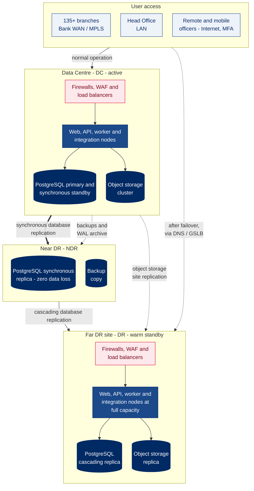
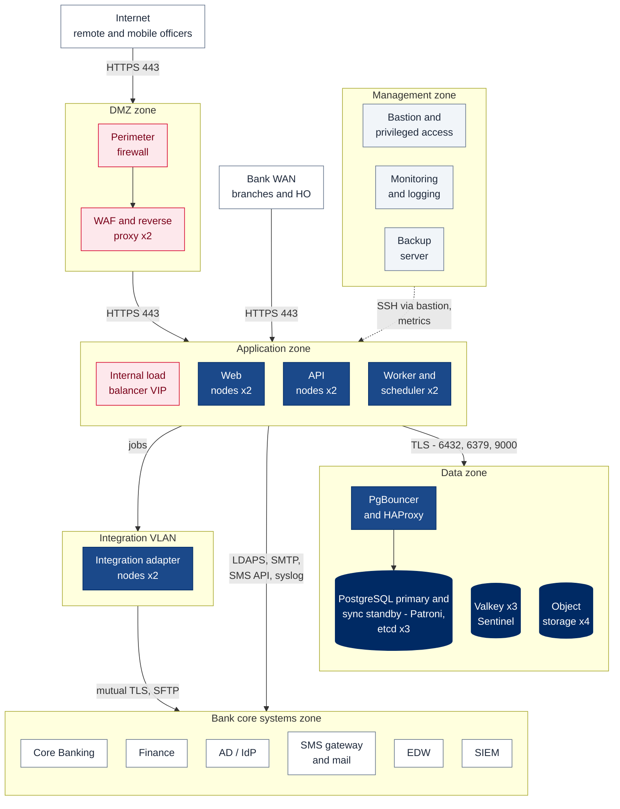
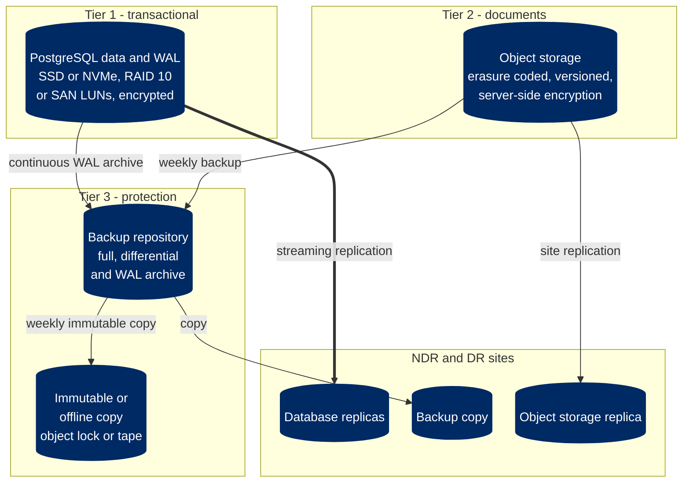
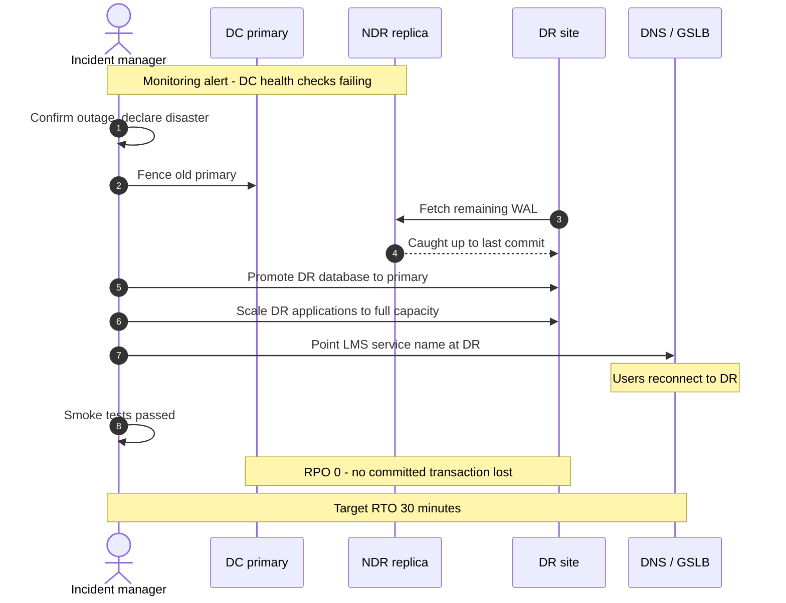

# 4. Network, Storage and Server Architecture

[← Back to index](README.md)

The LMS is deployed on-premises at Bank Asia (RFP §7.8.2) across three sites: the **Data Centre (DC)** runs production; the **Near DR (NDR)** holds a synchronous, zero-data-loss copy of the database; the **far DR site (DR)** holds a warm standby that can take over the full production load (RFP §7.2.7, §7.10). Test and UAT environments are separate (RFP §7.8.3).

## 4.1 Site topology

**Why this shape.** Synchronous replication to the NDR means a transaction is only acknowledged once it exists at two sites, so losing the DC loses no committed data. The far DR replica is fed from the NDR (cascading), so the DC carries the cost of only one synchronous link, and at failover the DR replica first catches up from the NDR before it is promoted. This meets the RFP's requirements for recovery with no loss of data (§7.10.4) and continuity through the DR site (§7.10.2).

## 4.2 Network zones inside the DC

| Zone | Contents | Reachable from | Notes |
|---|---|---|---|
| DMZ | Perimeter firewall, WAF and reverse proxy pair | Internet | Used only to publish the LMS to remote and mobile officers; MFA enforced. Branch and HO users never pass through the DMZ |
| Application | Internal load balancer, web, API, worker nodes | Bank WAN, DMZ | No inbound access from the Internet except through the WAF |
| Integration | Integration adapter nodes | Application zone only | Dedicated VLAN to CBS and peripheral systems (RFP §7.2.13); outbound connections only |
| Data | PostgreSQL, PgBouncer and HAProxy, etcd, Valkey, object storage | Application and integration zones, management zone | No user access; replication links to NDR and DR |
| Management | Bastion with privileged access management, monitoring, backup | Bank ICT administrators | All administrative access goes through the bastion and is recorded |
| Bank core systems | CBS, Finance, AD, SMS gateway, mail, EDW, SIEM | As per Bank policy | Existing Bank systems; the LMS consumes their interfaces |

Internal segmentation firewalls separate every zone. Each rule is allow-listed by source, destination and port; everything else is denied.

## 4.3 Port and protocol matrix (indicative)

| Source | Destination | Port | Protocol | Purpose |
|---|---|---|---|---|
| Branch and HO users | Internal load balancer | 443 | HTTPS | LMS web and API |
| Internet | WAF | 443 | HTTPS | Remote and mobile access |
| WAF | Internal load balancer | 443 | HTTPS | Published LMS endpoint |
| Load balancer | Web and API nodes | 443 | HTTPS | Re-encrypted application traffic |
| API and worker nodes | PgBouncer | 6432 | PostgreSQL over TLS | Pooled database connections |
| PgBouncer | PostgreSQL | 5432 | PostgreSQL over TLS | Database |
| API and worker nodes | Valkey | 6379 | RESP over TLS | Cache and job queue |
| API nodes | Object storage | 9000 | HTTPS (S3 API) | Documents |
| API nodes | AD / IdP | 443, 636 | HTTPS (SAML/OIDC), LDAPS | Single sign-on and directory |
| Integration nodes | CBS | Per CBS specification, typically 443 | HTTPS (REST or SOAP), mutual TLS | Lookup and posting |
| Integration nodes | CBS / Finance file servers | 22 | SFTP | End-of-day extracts, payment files |
| Worker nodes | Mail server | 587 | SMTP with STARTTLS | Email notifications |
| Worker nodes | SMS gateway | 443 (or 2775) | HTTPS API (or SMPP over TLS) | SMS notifications |
| PostgreSQL DC | PostgreSQL NDR | 5432 | Streaming replication over TLS | Synchronous replication |
| PostgreSQL NDR | PostgreSQL DR | 5432 | Streaming replication over TLS | Cascading replication |
| Object storage DC | Object storage DR | 9000 | HTTPS | Site replication |
| All nodes | SIEM | 6514 | Syslog over TLS | Security events |
| Monitoring | All nodes | 9100, 9187 | HTTPS (exporters) | Metrics |
| Bastion | All nodes | 22 | SSH | Administration, recorded |

## 4.4 Storage architecture

| Store | Initial usable capacity | Annual growth | Six-year provision | Notes |
|---|---|---|---|---|
| PostgreSQL (per node) | 500 GB SSD | ~15 GB | 500 GB | Structured data and audit log stay well under 100 GB over six years; headroom for indexes, WAL and maintenance |
| Object storage (usable) | 1.5 TB | ~300 GB | 4 TB usable | ~25,000 migrated cases with ~25 documents each; raw capacity depends on the erasure-coding scheme |
| Backup repository | 4 TB | ~1 TB | 8 TB | 35 days online plus 12 monthly fulls, and document backups |

Figures follow the sizing assumptions in the [index](README.md) and are refined in the design phase.

## 4.5 Backup and retention

| Data | Method | Frequency | Retention | Location |
|---|---|---|---|---|
| PostgreSQL | pgBackRest full and differential backups with continuous WAL archiving (point-in-time recovery) | Full weekly, differential daily, WAL continuous | 35 days online; monthly fulls for 12 months; yearly per Bank policy | DC repository, copied to NDR; weekly immutable copy |
| Documents | Object versioning, site replication, periodic backup | Replication continuous, backup weekly | Per Bank record-retention policy | DC, DR and immutable copy |
| Configuration | Version-controlled deployment configuration; vault snapshots | On every change; vault daily | 1 year | DC and DR |
| Application images | Private container registry, replicated | On every release | Last 10 releases | DC and DR |
| Logs and audit | Forwarded to SIEM; log archive | Continuous | Per Bank and Bangladesh Bank requirements | SIEM |

Restores are tested quarterly and the DR site is exercised at least twice a year, or as required by the Bank's ICT policy and Bangladesh Bank's ICT security guideline.

## 4.6 High availability and disaster recovery

| Failure | Mechanism | RPO | RTO |
|---|---|---|---|
| Web, API or worker node | Load balancer health checks remove the node; N+1 nodes carry the load | 0 | Under 1 minute |
| Database primary node | Patroni promotes the synchronous standby automatically; PgBouncer and HAProxy follow the new primary | 0 | Under 1 minute |
| Valkey node | Sentinel promotes a replica | Cache only — no business data | Under 1 minute |
| Object storage node or disk | Erasure coding tolerates node and disk loss | 0 | No interruption |
| Loss of the DC site | DR replica catches up from NDR, is promoted, DR applications scale up, DNS or GSLB switches users | 0 | 30 minutes target |
| Logical corruption or accidental deletion | Point-in-time restore from pgBackRest; document version restore | Under 5 minutes | Under 4 hours |
| Ransomware | Restore from immutable or offline backup | Last immutable copy | Under 24 hours |

The servers maintain integrity through power failure and abrupt shutdown (journaled file systems, database write-ahead log), restart without loss of data or software components, and alert administrators to inconsistencies (RFP §7.10.3–§7.10.5).

### DR failover sequence

Site failover is a deliberate decision by the incident manager under the Bank's business continuity plan, not an automatic one, so a network partition between sites can never produce two active primaries. The old primary is fenced first, so that if the DC comes back unexpectedly it cannot accept writes. Failback to the DC is planned and run as a scheduled change once the DC is restored.

## 4.7 Indicative server sizing

All roles run as virtual machines on the Bank's virtualisation platform, or on physical servers if the Bank prefers (RFP §6.53, §7.1.2). Sizes are per node.

**Production — DC**

| Role | Nodes | vCPU | RAM | Disk |
|---|---|---|---|---|
| Web (Next.js) | 2 | 4 | 8 GB | 80 GB |
| API (FastAPI) | 2 | 8 | 16 GB | 80 GB |
| Workers and scheduler | 2 | 4 | 8 GB | 80 GB |
| Integration adapters | 2 | 4 | 8 GB | 80 GB |
| PostgreSQL (Patroni) | 2 | 16 | 64 GB | 500 GB SSD |
| etcd (failover consensus) | 3 | 2 | 4 GB | 40 GB |
| Valkey with Sentinel | 3 | 2 | 4 GB | 40 GB |
| Object storage | 4 | 4 | 16 GB | 2 TB data disks |
| Monitoring and logging | 1 | 8 | 32 GB | 1 TB |
| Bastion | 1 | 2 | 4 GB | 40 GB |
| Backup server | 1 | 4 | 16 GB | 8 TB |

**NDR**: one PostgreSQL synchronous replica sized as a production database node, and a backup copy target (4 TB).

**DR**: the same application, database and object-storage roles as the DC, provisioned at full capacity so the DR site can carry the whole production load; the database starts as one cascading replica and a second node is added after failover.

**UAT and Test**: one node per role at roughly half the production size (web 2 vCPU / 4 GB, API 4 vCPU / 8 GB, worker 2 vCPU / 4 GB, integration 2 vCPU / 4 GB, PostgreSQL 8 vCPU / 32 GB / 250 GB, Valkey 2 vCPU / 4 GB, object storage 4 vCPU / 8 GB / 1 TB). The Test environment supports scripted simulation runs (RFP §7.2.6).

Operating system, database and middleware licences are listed in [Technology Layers](09-technology-layers.md); the stack is open source, so there are no per-core database licences.
