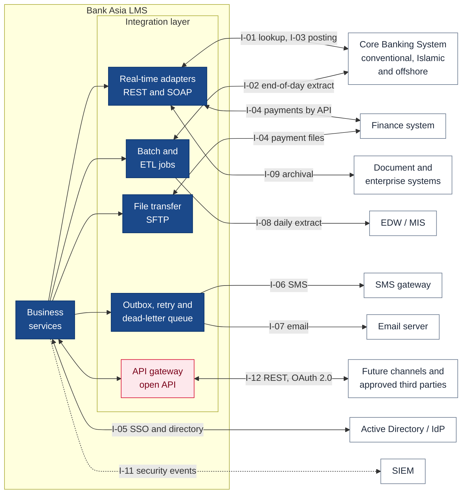
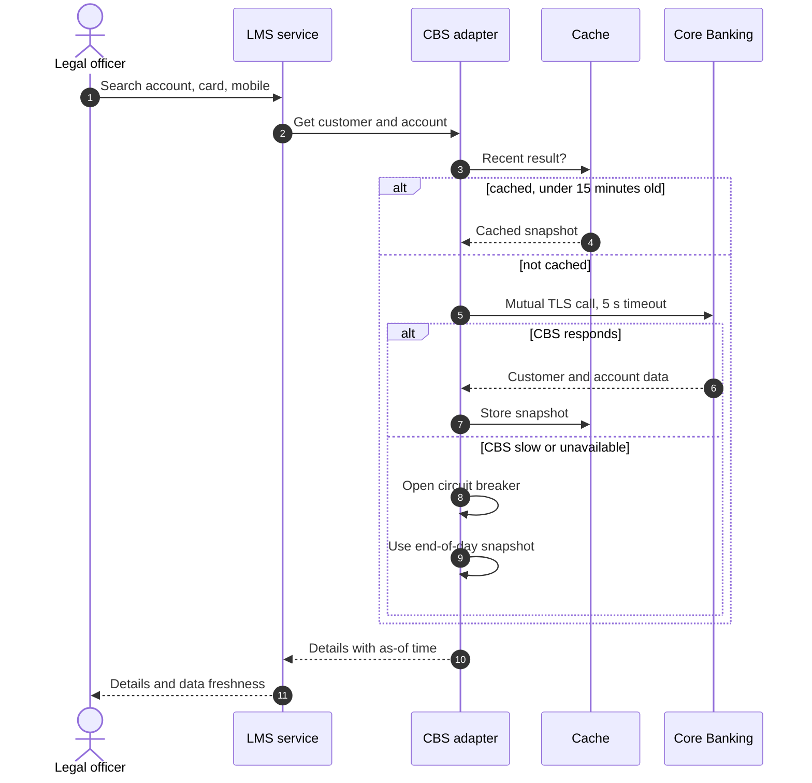
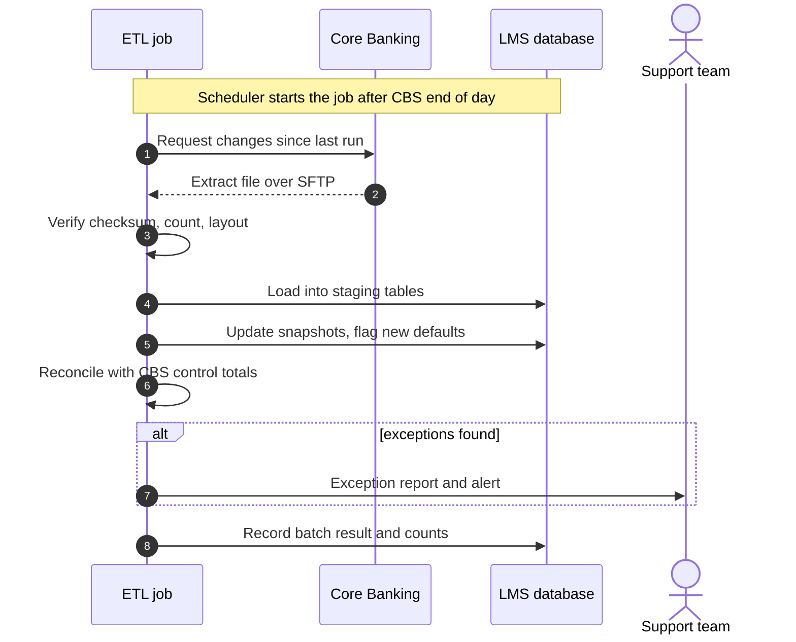
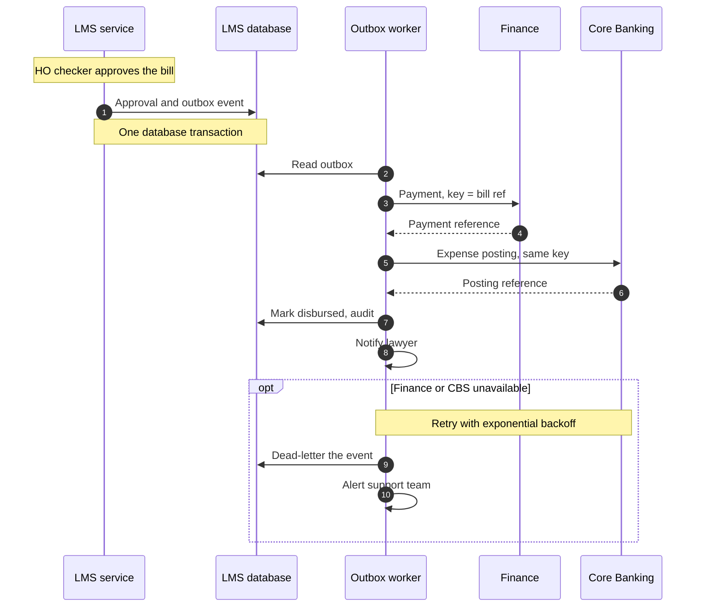

# 5. Integration Diagram

[← Back to index](README.md)

The LMS integrates with the Bank's Core Banking System and enterprise systems for customer and account data, payments and postings, identity, messaging and reporting (RFP §4(a), §7.3). Every integration goes through a dedicated adapter in the integration tier, on a dedicated network segment (RFP §7.2.13), so business modules never call an external system directly.

## 5.1 Integration landscape

## 5.2 Integration catalogue

| ID | System | Direction | Method | Protocol and format | Frequency | Key data | RFP |
|---|---|---|---|---|---|---|---|
| I-01 | CBS — customer and account lookup | CBS → LMS | Real-time API | REST/JSON or SOAP/XML over HTTPS, mutual TLS | On demand | Customer, account, outstanding, interest, unapplied interest, classification, repayment history | §4(a), §8.8.6, §8.27 |
| I-02 | CBS — end-of-day sync | CBS → LMS | Batch / ETL | CBS extract file over SFTP, or bulk API | Daily after CBS end of day | Balance changes, classification changes, newly defaulted accounts | §7.2.14 |
| I-03 | CBS — expense posting and legal flags | LMS → CBS | Real-time API | REST or SOAP, mutual TLS | On approval | Legal expense postings, legal-status markers on accounts | §8.16.11, §8.17.8 |
| I-04 | Finance system — payments | LMS ↔ Finance | API, or file where the API is not available | REST, or CSV over SFTP | On approval; confirmations daily | Payment instructions, payment confirmations and references | §8.16.13 |
| I-05 | Active Directory / identity provider | LMS ↔ IdP | Single sign-on and directory sync | SAML 2.0 or OpenID Connect; LDAPS | At login; directory sync hourly | Identity, group membership, account status | §7.9.6, §7.9.11 |
| I-06 | SMS gateway | LMS → gateway | API | HTTPS REST, or SMPP over TLS | Event-driven | Hearing reminders, approval requests, disbursement alerts | §7.3.4, §7.3.5 |
| I-07 | Email server | LMS → mail | SMTP | SMTP with STARTTLS | Event-driven | Notifications, scheduled reports | §7.3.4 |
| I-08 | EDW / MIS | LMS → EDW | Batch / ETL | Database extract or CSV over SFTP | Daily | Case, recovery, expense and workload facts | §7.3.6, §4(a) |
| I-09 | Document and enterprise systems | LMS ↔ DMS | API | REST or CMIS | On demand | Archival copies, retrieval of existing records | §4(a) |
| I-10 | Bangladesh Bank regulatory reporting | LMS → Bank's reporting channel | Generated files | PDF, Excel or CSV in Bangladesh Bank formats | Monthly and quarterly | সংযোজনী-ক/খ/গ, RIT, BR-4, DBI-22, CRMR, ISS, classified loans statement | §8.25 |
| I-11 | SIEM | LMS → SIEM | Log forwarding | Syslog over TLS, CEF | Continuous | Authentication, administration and security events | §7.11.15 |
| I-12 | Open API for future channels | Channels → LMS | API gateway | REST, OpenAPI 3, OAuth 2.0 | On demand | Case status, notices, approved third-party exchanges | §7.3.1, §7.3.2, §7.3.7 |

Bangladesh Bank returns (I-10) are generated by the LMS and submitted by authorised Bank users through the Bank's existing regulatory reporting channel; the RFP does not call for a direct connection to Bangladesh Bank.

## 5.3 Real-time CBS lookup

Used when an officer creates a legal notice, a CMA or a suit and searches for the customer by account, card or mobile number (RFP §8.8.6).

## 5.4 End-of-day synchronisation

Every batch run produces a success or failure report that lists failed items with the reason (RFP §7.11.7).

## 5.5 Payment and CBS posting — guaranteed delivery

Because the outbox event is written in the same transaction as the approval, an approved bill can never be lost between the LMS and Finance; because every call carries the bill reference as its idempotency key, a retry can never pay or post twice.

## 5.6 Integration principles

| Principle | Implementation |
|---|---|
| One adapter per system | CBS, Finance, IdP, SMS, email, EDW and DMS each have their own adapter, which owns protocol, mapping and error handling. A change on the CBS side touches only the CBS adapter |
| Contract first | Every interface is specified (OpenAPI, WSDL or file layout) and signed off with the system owner before build |
| Guaranteed delivery | Transactional outbox, retries with exponential backoff, dead-letter queue, operator alerts |
| Exactly-once effect | Idempotency keys on every posting and payment; duplicate responses are recognised and ignored |
| Resilience | Timeouts on every call, circuit breakers, degraded mode using the last end-of-day snapshot |
| Real-time and batch | Real-time APIs for lookups and postings; batch for bulk sync and extracts (RFP §7.2.15, §7.3.7) |
| Bi-directional with CBS | Inbound account data and outbound postings and legal-status flags (RFP §4(a)) |
| Security | Mutual TLS, dedicated service accounts with least privilege, IP allow-listing on the integration VLAN, secrets in the vault |
| Observability | Per-interface dashboards for volume, latency and errors; batch success and failure reports; alerts to the support team |
| Change readiness | Adapters and mappings are configurable, so new CBS fields or upgraded interfaces need no change to business modules (RFP §7.3.3) |

Integrations required before UAT completion are delivered as part of the implementation (RFP §6.44).
