# 6. Level-0 (Context) Diagram

[← Back to index](README.md)

The Level-0 data flow diagram treats the whole LMS as a single process and shows every external entity it exchanges data with, and what flows in each direction. It fixes the system boundary: anything outside the circle is a user, a Bank system or an external party, not part of the LMS. The Level-1 decomposition is in [Data Flow Diagram](03-dataflow-diagram.md).

```mermaid
---
config:
  layout: dagre
  look: classic
  flowchart:
    nodeSpacing: 30
    rankSpacing: 40
    padding: 10
---
flowchart LR
  subgraph PEOPLE["Bank users"]
    BU["Branch officers<br/>and managers"]:::user
    HO["HO Legal Division"]:::user
    MG["Management and<br/>internal audit"]:::user
    SA["System and security<br/>administrators"]:::user
  end

  LMS(("0 - Bank Asia LMS")):::lms

  subgraph SYS["Bank systems"]
    CBS["Core Banking System"]:::ext
    FIN["Finance system"]:::ext
    IDP["Active Directory / SSO"]:::ext
    MSG["SMS gateway and<br/>email server"]:::ext
    EDW["EDW / MIS"]:::ext
    SIEM["SIEM and<br/>security operations"]:::ext
  end

  subgraph EXTP["External parties"]
    PL["Panel lawyers"]:::ext
    BG["Borrowers and<br/>guarantors"]:::ext
    PV["Newspapers and<br/>paper vendors"]:::ext
    BB["Bangladesh Bank"]:::ext
  end

  BU <-->|"notices, cases, bills /<br/>tasks, alerts, status"| LMS
  HO <-->|"approvals, opinions /<br/>dashboards, escalations"| LMS
  MG <-->|"report requests /<br/>MIS, audit trails"| LMS
  SA <-->|"users, roles, settings /<br/>logs, system health"| LMS
  LMS <-->|"account data /<br/>postings, legal flags"| CBS
  LMS <-->|"confirmations /<br/>payment instructions"| FIN
  LMS <-->|"identity, SSO /<br/>sign-in requests"| IDP
  LMS <-->|"delivery status /<br/>messages to send"| MSG
  LMS -->|"daily extracts"| EDW
  LMS -->|"security events"| SIEM
  LMS -->|"reminders, bill alerts"| PL
  LMS -->|"legal notices"| BG
  LMS -->|"publication requests"| PV
  LMS -->|"regulatory returns"| BB

  classDef user fill:#EEF3FA,stroke:#1B498A,color:#002A64
  classDef lms fill:#1B498A,stroke:#002A64,color:#FFFFFF
  classDef ext fill:#FFFFFF,stroke:#64748B,color:#1E293B
```

A two-way arrow carries flows in both directions; its label reads *into the LMS / out of the LMS*. The table gives the full list of flows for each entity.

## External entities and data flows

| External entity | Data into the LMS | Data out of the LMS | Channel |
|---|---|---|---|
| Branch officers and managers | Legal notices, CMA requests, suit files, case steps, bills, bail and warrant records, authorization requests, documents | Tasks, alerts, approval requests, case status, printed notices and memos | LMS web application over the Bank WAN |
| HO Legal Division | Reviews and approvals, legal opinions, memos and notices, parameter changes | Dashboards, workload views, escalations, Case 360 and Customer 360 views | LMS web application |
| Management and internal audit | Report requests and filters | MIS, Bangladesh Bank formats, audit-trail queries | LMS web application |
| System and security administrators | Users, roles, groups, system settings, password and session policies | Login and activity history, active and inactive users, system health | LMS administration screens |
| Core Banking System | Customer, account, outstanding, interest, unapplied interest, classification, repayment history | Legal expense postings, legal-status flags | Integration adapters — real-time API and end-of-day extract |
| Finance system | Payment confirmations and references | Payment instructions for approved bills | Integration adapters — API or SFTP |
| Active Directory / SSO | Identity, group membership, SSO assertions, account status | Sign-in requests and directory queries | SAML or OIDC, LDAPS |
| SMS gateway and email server | Delivery status | SMS and email messages | HTTPS API or SMPP; SMTP |
| EDW / MIS | — | Daily case, recovery and expense extracts | Batch extract |
| SIEM and security operations | — | Security events, audit logs | Syslog over TLS |
| Panel lawyers | Bills and case updates, entered by legal officers | Hearing reminders, update requests, bill and payment alerts | SMS and email through the Bank's gateways |
| Borrowers and guarantors | — | Legal and reminder notices, generated by the LMS and served by the Bank | Printed and dispatched by the Bank |
| Newspapers and paper vendors | Publication bills, entered by officers | Auction and summons publication requests | Email or SMS |
| Bangladesh Bank | — | Regulatory returns in Bangladesh Bank formats | Generated files, submitted through the Bank's regulatory reporting channel |

## Boundary notes

- **Courts** are not connected to the LMS. Hearing dates, orders and judgments enter through legal officers, and copies are uploaded as documents.
- **Panel lawyers, borrowers and vendors** do not log in to the LMS. They receive messages and documents from it, and their bills and updates are entered by Bank officers. A lawyer self-service portal can be added later through the open API (integration I-12) without changing this boundary for Bank users.
- Messages to lawyers, borrowers and vendors are shown as direct flows because they are the business outcome; physically they travel through the Bank's SMS gateway and mail server, which is why those appear as an entity too.
