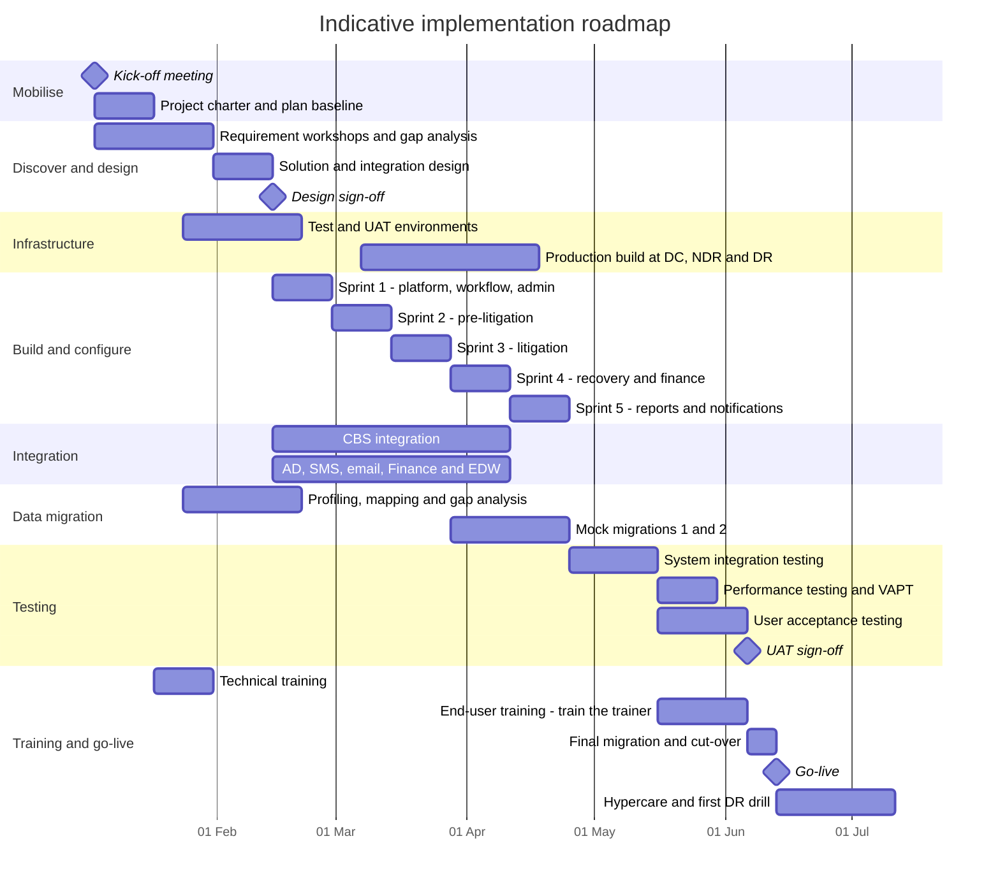
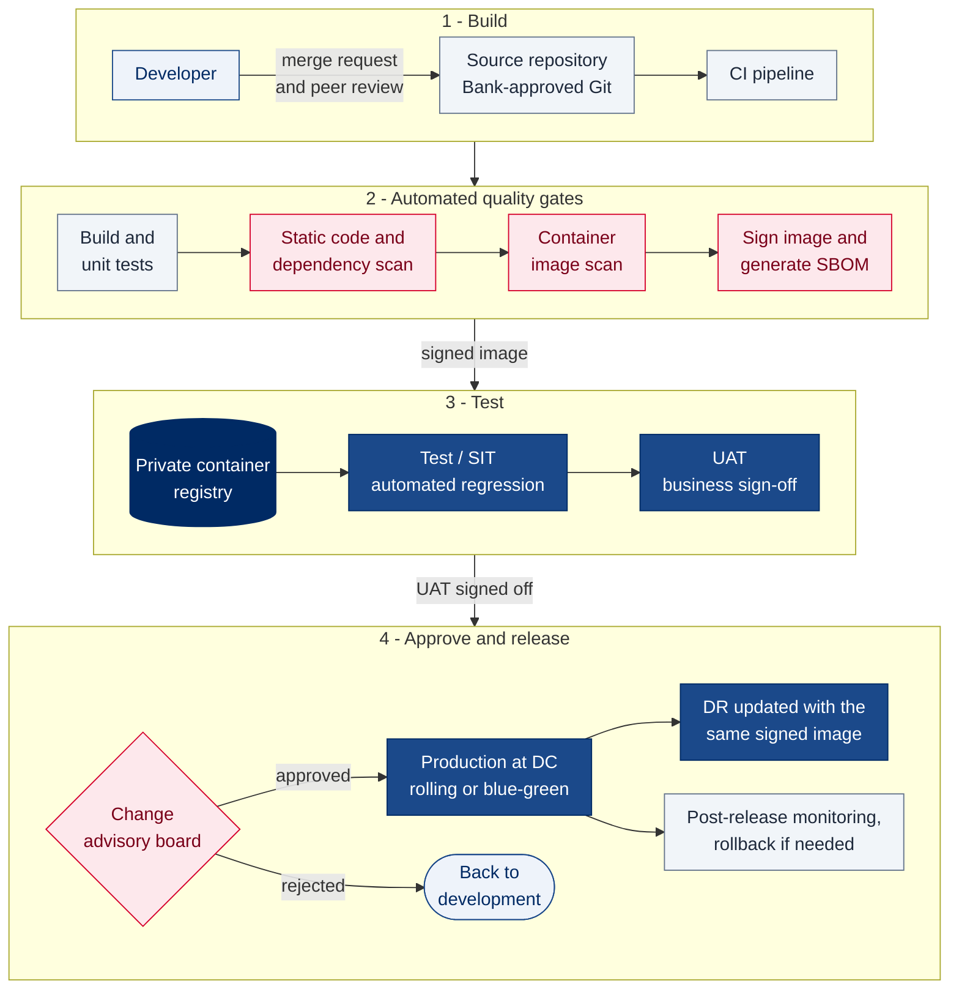
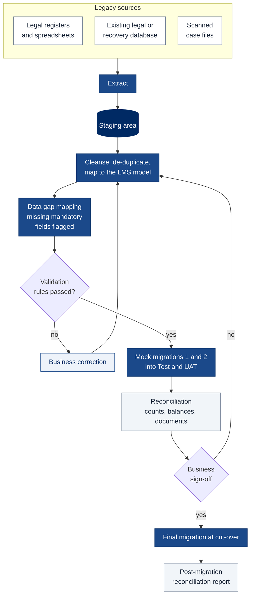
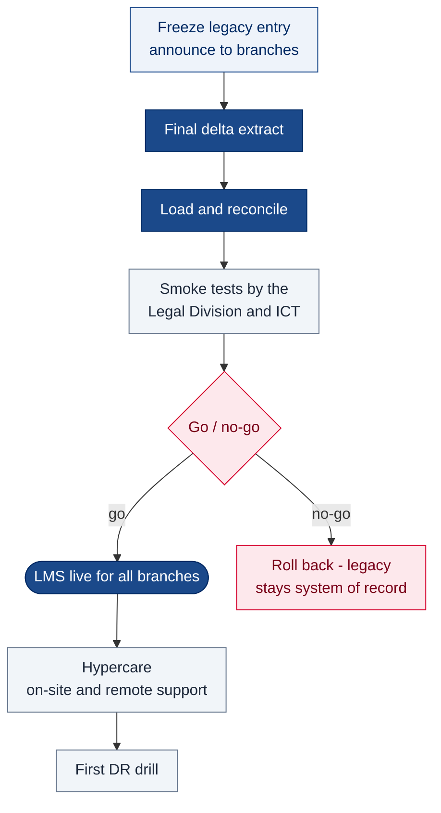
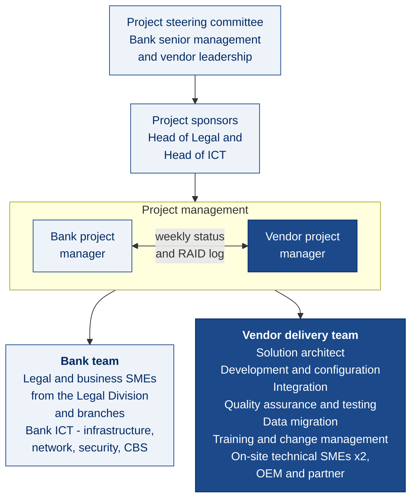
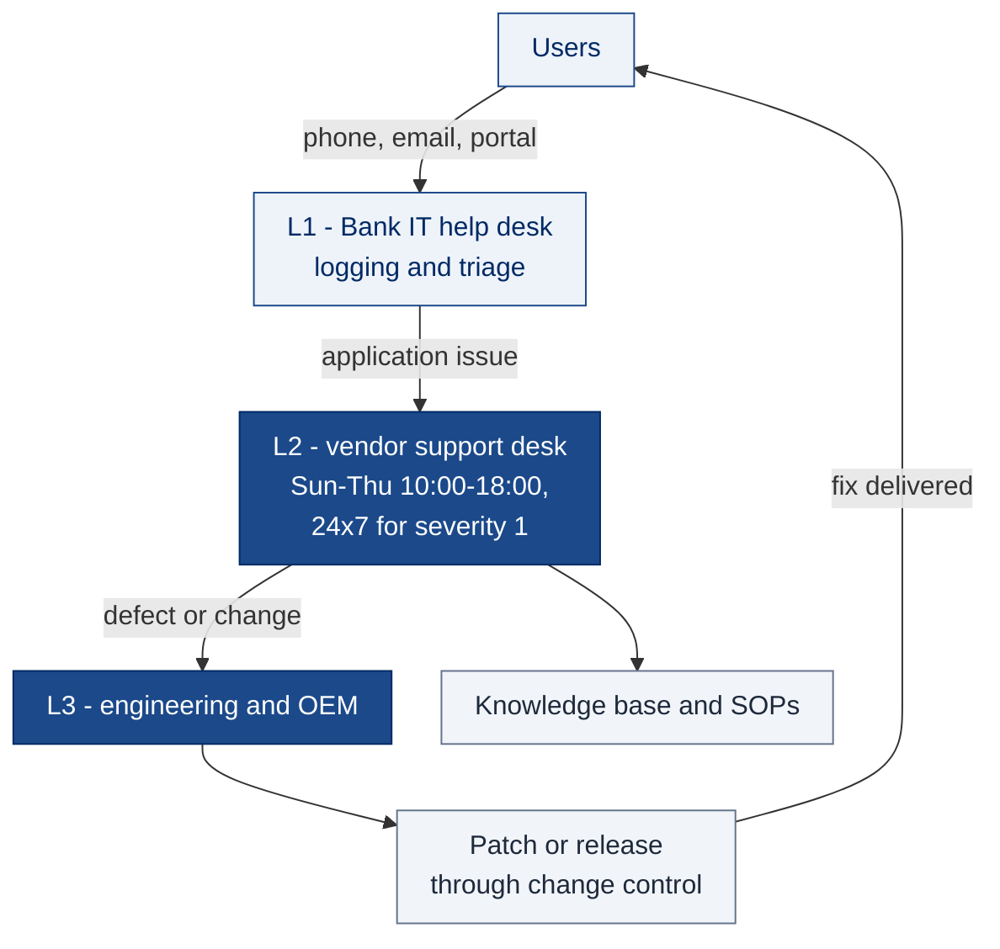

# 7. Implementation Diagram

[← Back to index](README.md)

How the LMS goes from contract to a supported production system: the phased roadmap, the environments and release pipeline, the data migration and cut-over approach, the project organisation, and the support model after go-live (RFP §6.8 items 9–10, §6.52).

## 7.1 Implementation roadmap

A phased plan of about 23 weeks from kick-off to go-live, followed by four weeks of hypercare. Durations are indicative and are baselined in the detailed project plan after the requirement workshops; calendar dates assume kick-off on 3 January 2027 purely for illustration. Delay is measured from the kick-off meeting (RFP §6.58(c)).

| Phase | Key deliverables | Exit criteria |
|---|---|---|
| Mobilise | Project charter, plan, governance, RAID log, communication and escalation matrix | Plan baselined with the Bank |
| Discover and design | Requirement specification, gap analysis against RFP §8, solution design, integration specifications, data dictionary, security design | Design signed off by the Bank |
| Infrastructure | Test, UAT and production environments at DC, NDR and DR; hardening; security review | Environments accepted by Bank ICT |
| Build and configure | Five sprints of configured modules, each demonstrated to the Legal Division | Sprint acceptance by business owners |
| Integration | CBS, AD/SSO, SMS, email, Finance and EDW interfaces built to signed specifications | Interface tests passed with each system owner |
| Data migration | Mapping, data gap report (RFP §7.4.4), two mock migrations with reconciliation | Reconciliation signed off by business |
| Testing | SIT, performance test, VAPT, UAT with the Legal Division | Zero open critical or high defects; UAT signed |
| Training and go-live | Technical and end-user training, SOPs (RFP §6.43), cut-over, go-live, hypercare, first DR drill | Go-live sign-off; warranty starts (RFP §6.51) |

After go-live the solution is under a three-year warranty with support, followed by three years of AMC (RFP §6.33–§6.35).

## 7.2 Environments and release pipeline

| Environment | Purpose | Data | Integrations |
|---|---|---|---|
| Development (vendor) | Build and unit testing | Synthetic | Simulated CBS, SMS and email |
| Test / SIT | System integration and regression testing; scripted simulation runs (RFP §7.2.6) | Masked copy of migrated data | CBS and gateway test endpoints |
| UAT | Business acceptance by the Legal Division | Masked production-like data | CBS and gateway UAT endpoints |
| Production — DC | Live service | Production | Production |
| Production — NDR and DR | Continuity | Replicas of production | Production endpoints, activated on failover |

The same signed container image moves unchanged from Test to UAT to production; only environment configuration differs (RFP §7.8.3). Every production release goes through the Bank's change control, with a tested rollback.

## 7.3 Data migration

Existing data is migrated into the LMS (RFP §7.4.3), and fields that have no legacy source are identified and mapped up front (RFP §7.4.4).

## 7.4 Cut-over

Legacy sources remain available read-only for an agreed period after go-live, so any migrated record can be traced back to its source.

## 7.5 Project organisation

At least two technical subject-matter experts, preferably one from the OEM and one from the partner, are on site through to project completion (RFP §6.28).

| Escalation level | Bank | Vendor | Raised when |
|---|---|---|---|
| 1 | Workstream lead | Workstream lead | Issue not resolved within 2 working days |
| 2 | Bank project manager | Vendor project manager | Not resolved within 5 working days, or threatens a milestone |
| 3 | Project steering committee | Vendor leadership | Threatens go-live, budget or a contractual obligation |

## 7.6 Support model after go-live

| Severity | Definition | Response | Restore or workaround | Resolution |
|---|---|---|---|---|
| 1 — Critical | Service down, or data integrity at risk | 30 minutes, 24x7 | 4 hours | 24 hours |
| 2 — High | Major function unavailable with no workaround | 2 hours | 8 hours | 3 working days |
| 3 — Medium | Function impaired, workaround available | 4 working hours | — | 10 working days |
| 4 — Low | Cosmetic issue, query or enhancement request | 1 working day | — | Next scheduled release |

The help desk runs 10:00–18:00, Sunday to Thursday (RFP §7.2.1), with 24x7x365 cover for critical incidents under warranty and AMC (RFP §6.45). Patches, security fixes and upgrades are delivered on a published schedule (RFP §6.27, §6.46). Response and resolution times above are proposed and are finalised in the SLA.
