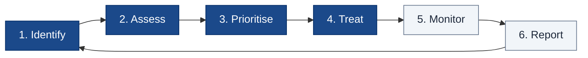
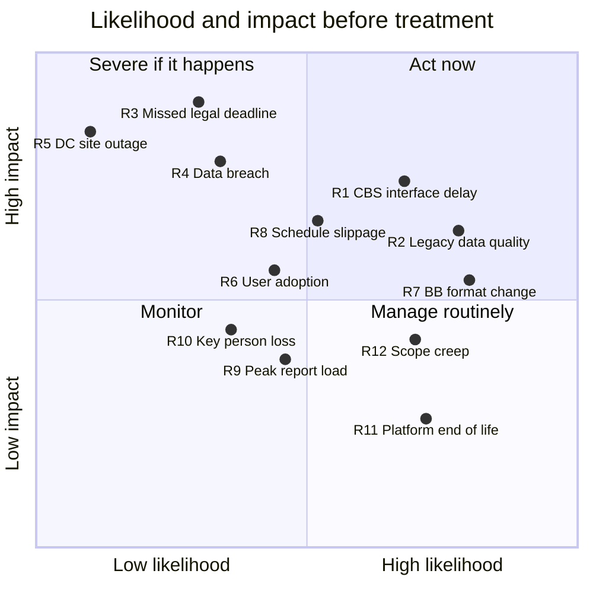
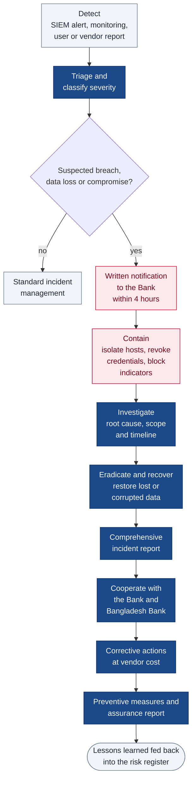

# 8. Risk Management

[← Back to index](README.md)

How project and operational risks are identified, rated, treated and reported, the principal risks for this implementation, and the response process for security incidents and data breaches (RFP §6.48).

## 8.1 Risk management process

| Step | What happens |
|---|---|
| 1. Identify | Risks raised in workshops, from incidents and audits, and with every change request |
| 2. Assess | Likelihood and impact each scored 1–5 |
| 3. Prioritise | Risks ranked by rating (likelihood × impact) |
| 4. Treat | Avoid, mitigate, transfer or accept, with a named owner |
| 5. Monitor | Owners track triggers and key risk indicators |
| 6. Report | Monthly report to the steering committee |

Risks are held in a shared risk register reviewed weekly by the two project managers and monthly by the steering committee. During warranty and AMC the register continues as the operational risk log.

**Rating scale.** Likelihood and impact are each scored 1–5. Rating = likelihood × impact: **1–4 Low**, **5–9 Medium**, **10–14 High**, **15–25 Critical**.

| Score | Likelihood | Impact |
|---|---|---|
| 1 | Rare | Negligible — no effect on users or schedule |
| 2 | Unlikely | Minor — small delay or limited inconvenience |
| 3 | Possible | Moderate — a module or milestone affected |
| 4 | Likely | Major — go-live, a key integration or a regulatory return affected |
| 5 | Almost certain | Severe — data loss or breach, regulatory breach, or financial or legal loss to the Bank |

## 8.2 Risk heat map — before treatment

Each risk is plotted in the cell for its likelihood and impact scores in the register below (score 1 at the low end of an axis, 5 at the high end); risks with the same scores are offset slightly so that every label stays readable. A score of 3 sits on the midline, so medium risks fall close to the centre.

## 8.3 Risk register

| ID | Risk | Category | L | I | Rating | Treatment | Owner | Residual |
|---|---|---|---|---|---|---|---|---|
| R1 | CBS interface specifications, test access or changes arrive late, delaying integration | Integration | 4 | 4 | **Critical (16)** | Interface workshop with the CBS vendor in the first two weeks; contract-first specifications; CBS adapter behind an interface so build proceeds against a simulator; end-of-day file integration as fallback | Joint | Medium |
| R2 | Legacy data is incomplete or inconsistent, so migrated cases are wrong or missing | Data | 4 | 4 | **Critical (16)** | Data profiling in weeks 3–6; data gap mapping (RFP §7.4.4); two mock migrations with reconciliation; business sign-off before final load; legacy kept read-only after go-live | Joint | Medium |
| R3 | A hearing or limitation deadline is missed because a notification is not sent or not seen | Legal and operational | 2 | 5 | **High (10)** | Redundant channels (SMS, email, in-app, dashboard due-list); court-holiday-aware scheduling; delivery tracking with failed-send alerts; escalation to supervisor when no update; scheduler heartbeat monitoring | Bank Legal / Vendor | Low |
| R4 | Unauthorised access to, or breach of, customer and case data | Security | 2 | 5 | **High (10)** | RBAC with branch scope; SSO and MFA; encryption in transit and at rest; OWASP controls; VAPT before go-live and yearly; SIEM monitoring; tamper-evident audit; 4-hour breach notification (§8.5) | Joint | Low |
| R5 | Loss of the DC site interrupts service | Infrastructure | 1 | 5 | **Medium (5)** | DC, NDR and DR with synchronous replication; documented failover runbook; DR drills at least twice a year | Bank ICT | Low |
| R6 | Branch users do not adopt the system and keep parallel registers | Organisational | 3 | 3 | **Medium (9)** | Role-based training with train-the-trainer; SOPs; in-app guidance; hypercare; adoption dashboard by branch; legacy entry frozen at cut-over | Bank Legal | Low |
| R7 | Bangladesh Bank changes a return format or adds a new return | Regulatory | 4 | 3 | **High (12)** | Report templates configurable without code; template versioning; regression tests for every BB format; change handled under AMC | Vendor | Low |
| R8 | Schedule slips, triggering the contractual delay penalty (1% per week, capped at 10%) | Project | 3 | 4 | **High (12)** | Baselined plan with buffers; weekly critical-path review; integration started in parallel with build; early escalation through the steering committee | Vendor | Medium |
| R9 | Reporting peaks at month and quarter end slow down data entry | Performance | 3 | 3 | **Medium (9)** | Reporting replica; heavy reports run in the background; pre-computed aggregates; load test at 2x expected peak before go-live | Vendor | Low |
| R10 | Loss of key project or support personnel | Resourcing | 3 | 3 | **Medium (9)** | Documentation and knowledge transfer; no single-person ownership of a component; OEM backing; Bank ICT shadowing during implementation | Vendor | Low |
| R11 | Platform components reach end of life during the six-year support term (RFP §6.30) | Technology | 4 | 2 | **Medium (8)** | Version roadmap kept under AMC; major upgrades of PostgreSQL, Python, Node.js and Next.js scheduled at least six months before end of life; automated regression tests | Vendor | Low |
| R12 | Uncontrolled change requests expand scope | Project | 4 | 3 | **High (12)** | Scope baselined on RFP Section 8 and the signed design; change advisory board with impact assessment; prioritised backlog | Joint | Low |

## 8.4 Controls by risk area

| Area | Preventive controls | Detective controls | Corrective controls |
|---|---|---|---|
| Access | SSO, MFA for remote access, RBAC with branch scope, session timeout, lockout, terminal and time restrictions (RFP §7.9) | Login and activity history, failed-login alerts, periodic access review | Account lock, credential revocation, role correction |
| Application | Secure coding standard, code review, static analysis, dependency scanning, OWASP Top 10 controls (RFP §7.11.6) | DAST, yearly VAPT, WAF alerts | Patch within the advisory window (RFP §7.11.12) |
| Data | Encryption, masking, least-privilege database roles, maker–checker | Audit trail queries, hash-chain verification, reconciliation reports | Version restore, point-in-time recovery |
| Integration | Mutual TLS, idempotency keys, contract tests | Interface dashboards, batch failure reports (RFP §7.11.7) | Retry, dead-letter replay, manual reconciliation |
| Infrastructure | Redundancy in every tier, hardening baselines, segmentation | Monitoring and alerting, capacity trends | Automatic failover, DR activation, restore from backup |
| Operations | Change control, release pipeline with quality gates, SOPs | Post-release monitoring, incident trends | Rollback, problem management |

## 8.5 Security incident and data breach response

| Step | Obligation | RFP |
|---|---|---|
| Notify | Written notice to the Bank within 4 hours of becoming aware, with preliminary details | §6.48(i) |
| Report | Comprehensive report on nature, cause, scope, timing and potential impact | §6.48(ii) |
| Cooperate | Full cooperation with the Bank, its representatives and Bangladesh Bank | §6.48(iii) |
| Correct | Containment and remediation at the vendor's cost, including full restoration of lost or corrupted data | §6.48(iv) |
| Prevent | Preventive measures and an assurance report on the remedial actions taken | §6.48(v) |

Business continuity for site-level failures — DC, NDR and DR, failover and drills — is covered in [Network, Storage and Server Architecture](04-network-storage-server.md#46-high-availability-and-disaster-recovery).
