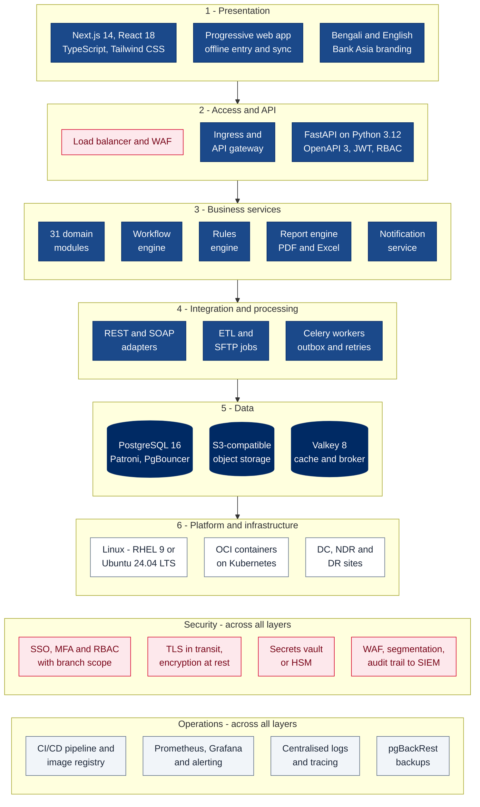

# 9. Technology Layers

[← Back to index](README.md)

The technology stack, layer by layer, with the version proposed for production and the reason for each choice. The stack is open standards and open source throughout, so the Bank pays no per-user or per-core runtime licence fees, and the application tier proposed here is the same one running in the live demo.

## 9.1 Layer diagram

## 9.2 Technology by layer

| Layer | Component | Technology | Proposed version | Why | RFP |
|---|---|---|---|---|---|
| Presentation | Web application | Next.js (App Router), React, TypeScript | Next.js 14 on the latest patched release; React 18; TypeScript 5 | Mature, widely supported; one codebase for desktop, tablet and mobile; type safety | §7.2.4, §7.11.4 |
| Presentation | Styling and components | Tailwind CSS, Radix UI primitives | Tailwind 3 | Consistent, accessible components; Bank Asia branding through design tokens | §7.2.9, §7.2.12 |
| Presentation | Mobile and offline | Progressive web app — service worker, offline queue in IndexedDB, background sync | — | Meets the mobile and offline-entry requirement without separate native apps | §8.23.14–§8.23.17 |
| Presentation | Language | Externalised message catalogues, Unicode throughout, Noto Sans Bengali in generated PDFs | — | Bengali and English on screens, notices and reports | §7.2.5 |
| Presentation | Runtime | Node.js | 24 LTS (the demo runs 22 LTS, which ends support in April 2027) | Supported runtime for the full warranty period | §7.11.16 |
| Access and API | API framework | FastAPI, Pydantic, Uvicorn under Gunicorn | FastAPI 0.115, Pydantic 2 | High performance, automatic OpenAPI contracts, strict input validation | §7.2.15, §7.3.7 |
| Access and API | Language runtime | Python | 3.12 | Supported until October 2028; validated in the demo | §7.11.16 |
| Access and API | Ingress and API gateway | NGINX ingress; Kong (open source) for the open API | Current stable | Routing, TLS, rate limiting, OAuth 2.0 for third-party access | §7.3.1, §7.3.2 |
| Business services | Workflow engine | Shared maker–checker state machine, configurable tiers and parallel stages | — | One implementation for every request type | §7.5.1, §8.9–§8.24 |
| Business services | Rules engine | Rule definitions in JSON-Logic, maintained by administrators | — | TATs, escalations and lead times changed without a release | §7.6.1 |
| Business services | Reports | WeasyPrint for PDF, openpyxl for Excel, Jinja2 templates | Current stable | Bangladesh Bank formats reproduced exactly; templates editable | §8.25 |
| Business services | Search | PostgreSQL full-text search and trigram matching | — | Name, account and case search without a separate search cluster | §8.24.3, §8.27 |
| Integration | Adapters | HTTPX for REST, Zeep for SOAP, Paramiko for SFTP | Current stable | Covers every integration method the RFP lists | §7.3.7 |
| Integration | Background jobs | Celery workers and Celery Beat scheduler, transactional outbox | Celery 5 | Notifications, report jobs, end-of-day sync, guaranteed delivery | §7.3.5, §8.26 |
| Data | Relational database | PostgreSQL with Patroni for automatic failover and PgBouncer for pooling | PostgreSQL 16 | Proven, open source, strong integrity; no per-core licence | §7.1.1, §7.10 |
| Data | Data access | SQLAlchemy ORM, Alembic migrations | SQLAlchemy 2.0 | Parameterised queries throughout; versioned schema changes | §7.11.6 |
| Data | Documents | S3-compatible object storage — the Bank's existing platform if available, otherwise MinIO or Ceph RGW | — | Scales to millions of files; versioning and encryption | §8.24 |
| Data | Cache and broker | Valkey (open source, Redis-compatible) with Sentinel | Valkey 8 | BSD-licensed; fast reference-data cache and job queue | — |
| Data | Backup | pgBackRest | Current stable | Full, differential and point-in-time recovery, encrypted | §7.10 |
| Platform | Operating system | Red Hat Enterprise Linux or Ubuntu LTS, per Bank standard | RHEL 9 or Ubuntu 24.04 LTS | Long-term vendor support, hardening baselines | §7.11.11 |
| Platform | Containers and orchestration | OCI container images; Kubernetes on the Bank's standard distribution, or Docker Swarm | — | Identical images in every environment; rolling updates; self-healing | §7.8.3 |
| Security | Identity | SAML 2.0 or OpenID Connect against the Bank's identity provider; LDAPS directory sync; TOTP or SMS OTP for MFA | — | Single sign-on with Active Directory; MFA for remote access | §7.9.6, §7.9.11, §8.23.16 |
| Security | Secrets | HashiCorp Vault or OpenBao, or the Bank's HSM | Current stable | Short-lived credentials; no secrets in code or configuration | §7.11.5 |
| Security | Application security testing | Static analysis, dependency and container scanning, DAST with OWASP ZAP, independent VAPT | — | OWASP Top 10 coverage; regular penetration testing | §7.11.6 |
| Operations | Monitoring | Prometheus, Grafana, Alertmanager | Current stable | Metrics and alerts for every tier; remote monitoring | §7.2.3, §7.10.5 |
| Operations | Logs and tracing | Grafana Loki or the Bank's ELK stack; OpenTelemetry | Current stable | Searchable logs; end-to-end request tracing | §7.11.10 |
| Operations | Delivery | GitLab CE or Jenkins per Bank standard; Harbor registry; image signing and SBOM | Current stable | Repeatable, auditable releases | §6.46 |

Versions marked *current stable* are fixed at design sign-off and then kept current under AMC; the version roadmap and upgrade schedule are tracked as risk R11 in [Risk Management](08-risk-management.md).

## 9.3 Standards and protocols

| Area | Standards |
|---|---|
| Transport security | TLS 1.2 minimum, TLS 1.3 preferred; HSTS; mutual TLS for system-to-system |
| APIs | REST with OpenAPI 3, JSON; SOAP 1.1/1.2 with WSDL where CBS requires it |
| Identity | SAML 2.0, OpenID Connect, OAuth 2.0, LDAPv3 over TLS |
| Files and messaging | SFTP, CSV and fixed-width layouts; SMTP; SMPP 3.4 |
| Storage | SQL, S3 API |
| Logging | Syslog (RFC 5424) over TLS, CEF for SIEM |
| Text | Unicode (UTF-8) end to end, so Bengali text is stored and searched natively |
| Application security | OWASP Top 10, OWASP ASVS as the verification checklist |

## 9.4 Licensing

| Item | Licence position | RFP |
|---|---|---|
| LMS application | Perpetual licence to the Bank | §7.9.1 |
| Runtime stack (PostgreSQL, Python, Node.js, Valkey, Celery, NGINX) | Open source; no licence fees | §6.54 |
| Copyleft components (for example Grafana or MinIO under AGPL-3.0) | Used unmodified for internal operations only; replaceable by the Bank's existing tools | §6.54 |
| Operating system | Red Hat subscription if the Bank standardises on RHEL; none for Ubuntu LTS | §6.54 |
| Third-party commercial software | None required; any the Bank chooses (for example a commercial WAF or load balancer) is listed in the BOQ | §6.40, §6.54 |

Every release ships with a software bill of materials, and dependencies are checked automatically for known vulnerabilities and licence conflicts, so all components stay licensed and current (RFP §7.11.16).
