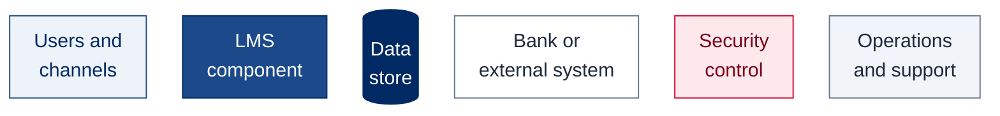
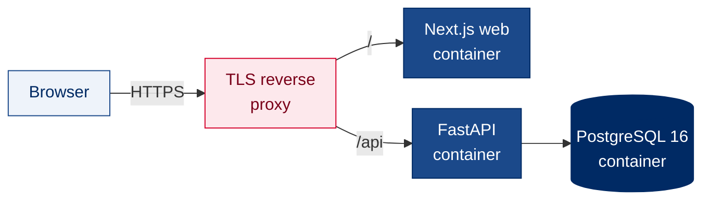

# Bank Asia LMS — System Architecture

Proposed target architecture for the **Bank Asia PLC Litigation Management System (LMS)**, prepared against the RFP *Procurement, supply, implementation, Integration and support of a Litigation Management System (LMS), including software licenses and Annual Maintenance Contract (AMC)* (v0.3). Every diagram is written in Mermaid and renders directly on GitHub.

## Document set

| # | Document | What it covers | RFP reference |
|---|---|---|---|
| 1 | [System Architecture](01-system-architecture.md) | Logical N-tier architecture, components, functional map, design principles, quality attributes | §7.1.1, §7.5, §7.6 |
| 2 | [Workflow Diagram](02-workflow-diagram.md) | Maker–checker approval chain and statuses, end-to-end legal case lifecycle, bill disbursement, notifications and escalation | §8.9–§8.24, §8.26 |
| 3 | [Data Flow Diagram](03-dataflow-diagram.md) | Level-1 DFD, logical data model, encryption on every hop, data classification | §7.1.1(h)(i), §7.2.16, §7.9.13 |
| 4 | [Network, Storage and Server Architecture](04-network-storage-server.md) | DC / NDR / DR topology, network zones and ports, storage and backup, HA and DR, indicative server sizing | §7.1.2, §7.2.7, §7.2.13, §7.8, §7.10 |
| 5 | [Integration Diagram](05-integration-diagram.md) | Integration landscape and catalogue, CBS real-time and end-of-day flows, finance payment and CBS posting | §4(a), §7.3 |
| 6 | [Level-0 (Context) Diagram](06-level-0-context-diagram.md) | The LMS as a single process and every external entity it exchanges data with | §7.1.1(h) |
| 7 | [Implementation Diagram](07-implementation-diagram.md) | Phased roadmap, environments and release pipeline, data migration, project organisation, support model | §6.8, §6.28, §6.52, §6.55, §7.4.3, §7.8.3 |
| 8 | [Risk Management](08-risk-management.md) | Risk process, heat map, risk register, incident and data-breach response | §6.48, §6.58, §7.10, §7.11 |
| 9 | [Technology Layers](09-technology-layers.md) | Technology stack by layer with versions, standards and licensing | §7.1, §7.3.7, §7.11.16 |

## Architecture at a glance

- **N-tier and on-premises.** Browser → web tier (Next.js) → API and business services (FastAPI) → PostgreSQL, object storage and cache. Deployed active at Bank Asia's **Data Centre (DC)**, with a zero-data-loss copy at the **Near DR (NDR)** and a warm standby at the **far DR** site (RFP §7.2.7, §7.8.2).
- **Modular monolith, scaled horizontally.** One codebase organised into domain modules (pre-litigation, litigation, recovery and finance, reporting, administration) on shared platform services (workflow, rules, documents, notifications, audit). Stateless application nodes scale out behind a load balancer.
- **Maker–checker everywhere.** A single workflow engine drives every request type, with configurable branch-level and head-office-level approval tiers, reasons on every return or rejection, and duplicate-request blocking.
- **Audit by default.** Every view, change and approval is written to an append-only, tamper-evident audit log and forwarded to the Bank's SIEM.
- **Integration through adapters.** CBS, Finance, AD/SSO, SMS, email and EDW are reached through dedicated adapters (real-time API, batch/ETL, SFTP) on a dedicated integration VLAN, with a transactional outbox and retry queue so no posting or notification is lost.
- **Security in depth.** WAF and network segmentation, SSO with MFA for remote access, role-based access with branch scoping, TLS on every hop, encryption at rest, OWASP Top 10 controls and periodic VAPT.

## Diagram conventions

The same colour key is used in every diagram.

Solid arrows are data or control flow; dotted arrows are replication, monitoring or management access; thick arrows are synchronous replication.

Each flowchart, state and entity diagram pins Mermaid's classic layout (`layout: dagre`, `look: classic`) in its front matter. Mermaid 12 changed the default layout engine, so without the pin the same diagram would be arranged differently depending on the viewer's Mermaid version; with it, the diagrams render the same on Mermaid 10, 11 and 12.

## Sizing assumptions

Server sizing and storage figures in this set are indicative and rest on the volumes below. Final sizing follows a capacity workshop with the Bank during the design phase.

| Parameter | Assumption |
|---|---|
| Named users | ~600 (135+ branches, HO Legal Division, management, audit) |
| Concurrent users at peak | ~200 |
| Cases at go-live (migrated) | ~25,000 across all case types |
| New cases per year | ~3,000 |
| Documents | ~25 per case, ~1.5 MB average |
| NDR distance | Within synchronous-replication range of DC (round trip under 5 ms) |

## Items to confirm at design sign-off

| Item | Proposed | Alternative |
|---|---|---|
| Container orchestration | Kubernetes on the Bank's standard distribution | Docker Swarm for a smaller footprint |
| Single sign-on | SAML 2.0 or OpenID Connect against the Bank's identity provider | LDAPS directory bind, with MFA for remote access |
| CBS integration | REST/SOAP API for lookup and posting, plus an end-of-day extract over SFTP | Read-only CBS reporting views |
| Object storage | S3-compatible storage (MinIO, or the Bank's existing S3-compatible platform) | Ceph RGW |
| Background jobs | Celery workers with a Valkey (Redis-compatible) broker | RQ or APScheduler |
| Mobile access (RFP §8.23.14) | Progressive web app with offline entry and sync | Native Android and iOS apps |
| PostgreSQL major version | 16, upgraded within the support term (see risk R11) | Latest supported major at design sign-off |

## Relationship to the live demo

The demo at **https://lms.skoder.co** is a working prototype of the screens, workflows and data model. It runs on a single cloud virtual server (Docker containers behind a TLS reverse proxy, PostgreSQL 16), with simulated CBS, SMS and email and a role-switcher in place of single sign-on. It validates the application stack proposed here (Next.js, FastAPI, PostgreSQL) but not the production topology: everything in this document set describes the proposed deployment at Bank Asia's DC, NDR and DR.

